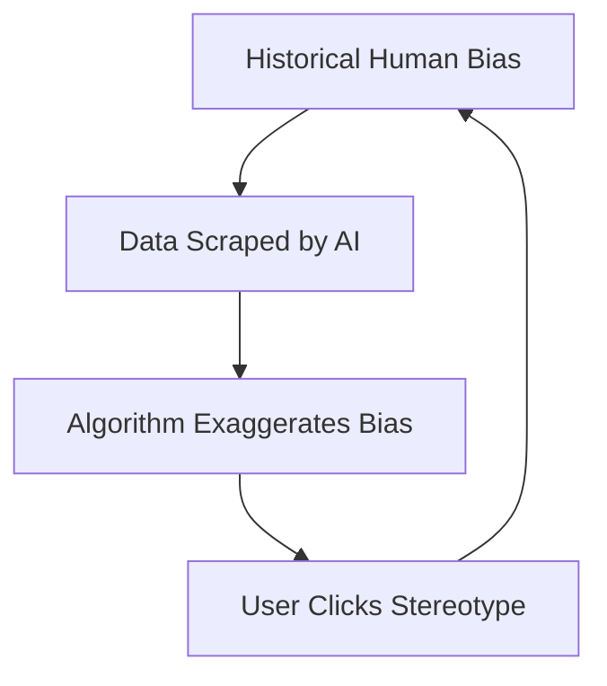
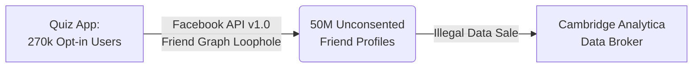
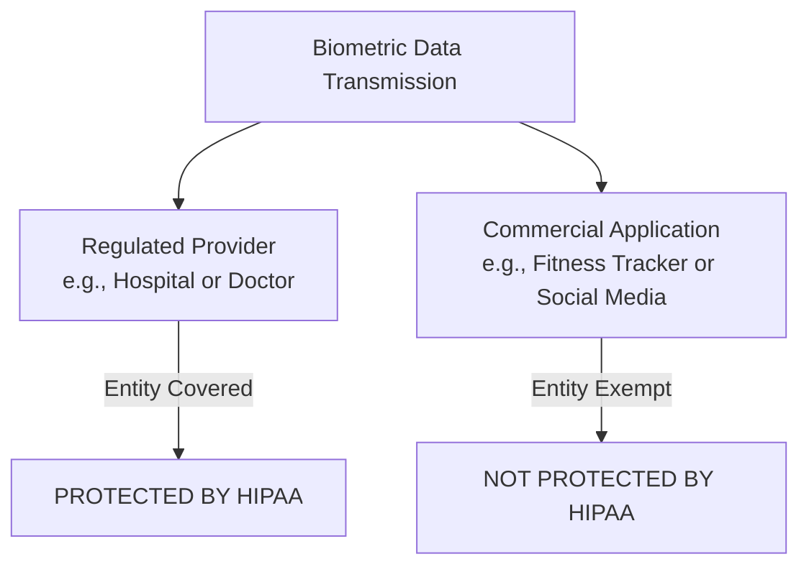
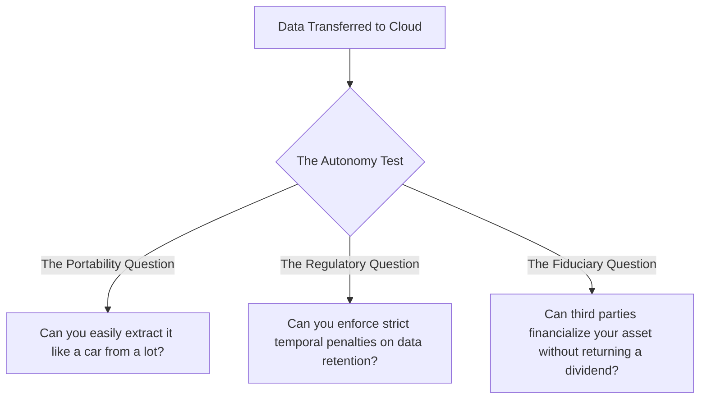
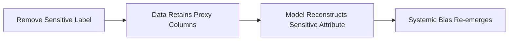

### A Brief Introduction!
_Abuse of big data means your worst fears can come true. Are they being monitored by your employer? Check. Government intrusions into your daily life? Check. Being turned down by college admissions because you are predicted not to donate in 10-20 years? Check. Sounds a bit like the visions in the Minority Report. Alas, machine learning algorithms are already being deployed by industry, government, and even schools to make decisions that impact us in direct ways. These programs are typically promoted as fair and free of human biases, but humans who make mistakes are programming, calibrating, and evaluating their performance. Thus resides the problem. How do we design algorithms that effectively deal with large amounts of data to train them while ensuring their outcomes aren't misused? In this course, not only will we examine various AI/ML techniques that can be used to counterbalance the potential abuse and misuse of learning from big data, but we will focus on the effects of these technologies on individuals, organizations, and society, paying close attention to what our responsibilities are as computing professionals._

## Module 1: Data, Individuals, and Society
### Lesson 1: Introduction
After completing this module, you should gain a good understanding of the power and impact that analytics AI Machine Learning have on individuals and society. We will cover a wide range of societal issues, ranging from fairness and bias to ethics, legality, data collection and privacy. My goal in this module is to leave you with a solid enough grounding to be able to understand as well as argue for, or against the concerns that might arise when deploying AI into society.

A grounding example from China's social credit system, which keeps an eye on each citizen's daily behavior: https://www.youtube.com/watch?v=Onm6Sb3Pb2Y.
#### What is Big Data?
> Big data is the term increasingly used to describe the process of applying serious computing power the latest in machine learning and artificial intelligence to seriously massive and often highly complex sets of information.
{: .prompt-info }

As an example on the scale of data, a stat from the year 2019 highlights 2.5 quintillion bytes of data created each day (via web search, social media platforms, etc.).

#### Why does this matter?
AI/ML algorithms are being deployed by organizations to make decisions that impact us in direct ways:
- filtering applicants for jobs, admissions, …
- approving applicants for loans, bank credit, credit cards, …
- predicting risk levels for insurance, health benefits, …
- user profiling for policing purposes and to predict risk of criminal recidivism, …
- identifying risk of developing mental health problems, …

#### Note on Terminology
Throughout this course, terms such as big data, Deep Learning, Machine Learning and AI will be used interchangeably (despite their differences) because they all impact the algorithms that we create (a lot of the abuse we see comes from the utilization of these tools.). Before we continue onto the next topic, let's take a brief look on how these are different (although we count them under the same bucket as discussed):
- Artificial Intelligence, AI, which is more than Machine Learning and Deep Learning. It encompasses both those fields.
- Deep Learning is a subset of Machine Learning, and mostly encompasses tools such as
Deep Neural Networks right now.

#### Statistics
Finally, we'll be examining how stats can both abuse algorithm outputs, but also help us mitigate some of the resulting biases.

### Lesson 2: Overview
#### Targeted Messaging
##### 1. The Mechanics of Targeted Advertising

* **The Reality:** Your online behaviors (likes, follows, shares) act as explicit data points that reveal private demographics.
    * *Example:* Following the NY Yankees signals geographic proximity (the Bronx); liking Georgia Tech posts allows algorithms to infer a college education.
* **Trial & Error Phase:** Companies initially use generalized metrics (e.g., target ranges like "singles aged 40–50") to test their reach.
* **The Feedback Loop:** Actions like clicking, liking, or retweeting serve as positive validation signals, confirming to the company that their profile targeting is accurate.
* **Democratization of Tools:** Ad targeting power is no longer exclusive to tech giants; anyone with a small budget can target niche audiences (e.g., promoting a local cat video).

##### 2. Data Anonymity is an Illusion

* **The PII Triad (Personally Identifiable Information):** Providing just three basic data points—**Birthdate, Gender, and ZIP code**—is statistically enough to uniquely identify a specific individual out of the entire US population with high probability.
* **The Failure of "Fake" Profiles:** Attempting to hide identity by falsifying profile setups (using slightly modified birth years or fake ZIP codes) is easily bypassed by backend network tracking.
* **IP-to-Location Tracking:** Simply logging online exposes your machine's IP address. Tools like geolocation web services immediately translate raw IP addresses into:
    * Country codes
    * Precise Latitude & Longitude coordinates
    * True local ZIP codes

##### 3. The Bigger Picture: Moving Beyond Ads
* **Historical Shift:** The level of granular data tracking and profiling seen today was entirely impossible two decades ago.
* **The Pipeline:** Raw platform data $\rightarrow$ Specialized Analytics Tools $\rightarrow$ Insights $\rightarrow$ Predictive AI Modeling.
* **The Real Threat:** Massive data aggregation led to the development of powerful parsing tools. Today, organizations and individuals leverage these data repositories to feed complex **Machine Learning and AI algorithms** that go far beyond commercial advertising, directly influencing behavioral outcomes.

#### What's the Problem?
> The Dangers of Algorithmic Generalization & Machine Learning Physiognomy

##### 1. The Core Algorithmic Problem: Group Generalization

* **Collective Targeting:** Algorithms do not see you as an isolated individual; they treat you as a data point within a collective group sharing similar historical behaviors.
* **The Bias Trap:** Machine Learning algorithms rely entirely on **historical data**. Because this data records human actions from the past, it directly embeds and preserves historical societal biases into future software choices.

##### 2. The Resurgence of Physiognomy in AI

> **Physiognomy:** The pseudoscientific practice of using a person's outer appearance or facial features to infer their inner character, morality, or personality.

{: w="200"}

###### _**Case Study A: The 16 Criminality Predictor (Wu & Zhang)_

* **The Claim:** A neural network could differentiate between "criminal" and "non-criminal" faces with nearly 90% accuracy, supposedly free from human prejudice.
* **The Flaw (Bad Training Data):**
    * **Criminal Set (700 photos):** Sourced from official police department mugshots (where individuals are under stress and naturally frowning).
    * **Non-Criminal Set (1,100 photos):** Scraped from the public web (where people self-select flattering, smiling headshots for job sites or dating apps).

* **The Reality:** The algorithm didn't map a internal "criminal nature"—it simply learned to differentiate between a frown and a smile.

###### _**Case Study B:he 2017 Sexual Orientation Classifier_

* **The Claim:** A deep neural network distinguished between gay and straight individuals with 80% accuracy for men and 74% for women.
* **The Flaw (Data Source Bias):** Images were pulled directly from a dating website where individuals actively curate specific aesthetic facial angles, expressions, and grooming habits to signal identity.
* **The Pseudoscience Conclusion:** The researchers claimed sexual orientation correlated with "gender-atypical facial morphology" (e.g., matching forehead size variations), mistaking social grooming indicators for biological traits.

---

##### 3. Historical Parallel: Cesare Lombroso’s "Born Criminal"

| Historical Pseudoscience (1876) | Modern Algorithmic Error (Present) |
| --- | --- |
| **Cesare Lombroso** measured skull contours, sloping foreheads, and hooked noses of prisoners. | **Deep Neural Networks** map facial pixel clusters, expressions, and landmarks. |
| Professed that criminality is a biological abnormality detectable on the surface. | Code outputs a high confidence percentage metric indicating criminality or preference. |
| **Debunked** as bad science driven by flawed data collection. | **Obfuscated** because complex math and neural networks hide the underlying bias under a veneer of "technological objectivity." |

> **Key Takeaway:** 150 years after Lombroso, modern AI is often used to re-validate thoroughly debunked scientific myths. Because automated systems wrap their choices in complex algorithms, it is significantly harder for the average user to separate algorithmic "hogwash" from absolute objective truth.

#### AI & Unintended Consequences
##### 1. Computer Vision & Facial Recognition Failures

###### _**UndeRepresentation of Diverse Populations_
Early facial recognition models routinely failed on non-Caucasian faces due to homogeneous training datasets:
* **Digital Camera Blinking Alerts (2010):** Systems repeatedly flashed a false *"Did someone blink?"* warning when capturing photos of Asian individuals.
* **Automated Passport Rejection:** A New Zealand passport system rejected an Asian applicant's photo for the same inaccurate reason—claiming the subject's eyes were closed.

###### _**The "Band-Aid" Patch Strateg**y_
When a Google Photos algorithm infamously mislabeled Black individuals as "gorillas" in 2015, the company's fix was to entirely block the word labels *gorilla, chimp, chimpanzee,* and *monkey*.

> **The Engineering Lesson:** Instead of restructuring the core model to understand diverse skin tones accurately, tech giants often deploy superficial patches that eliminate functionality entirely—rendering the app useless for someone like a primatologist.
{: .prompt-info }

---

##### 2. Natural Language Processing (NLP) & Audio Discrimination

* **Dialect and Accent Penalties:** A 2018 study highlighted that mainstream automated voice assistants performed significantly worse on users with local or non-native accents, jumping up to **30% more inaccuracies** for non-native speech.
* **The Gender Word Gap:** Google’s automatic speech recognition software historically suffered a **30% performance disparity** when transcribing female voices compared to male voices.
* **Algorithmic Mimicry (Microsoft's Tay):** Deployed on Twitter in 2016, the chatbot Tay was designed to learn from user interactions. Within 24 hours, bad actors fed it toxic language, causing it to spew hate speech. 
  * *Contrast:* A similar chatbot deployed by Microsoft in China interacted with 600 million users *without* this failure, proving that localized cultural input directly dictates an AI's behavior.
* **Hardcoded Structural Assumptions:** Gmail's smart-compose predictive text assumed default gender roles based on professional status (e.g., predicting *"Do you want to meet **him**?"* when a user typed *"I am meeting an investor"*). Google's response was simply to turn off gender prediction for those terms—masking the underlying data imbalance.

---

##### 3. Reinforcing and Exaggerating Social Stereotypes



* **Search Engine Mirroring:** In 2016, searching for *"three white teenagers"* pulled up clean, happy stock photos, while the search phrase *"three black teenagers"* returned an array of police mugshots. Search algorithms replicate the frequency and systemic bias inherent in existing online media.
* **The Profession Stereotype Loop:** Search queries for *"Doctor"* heavily skewed male, while *"Nurse"* skewed female. Because humans rate search results higher when they align with their pre-existing cognitive biases, users actively click the stereotypical image, creating a feedback loop that retrains the algorithm to suppress diverse results.

---

##### 4. Automated Hiring & Predictive Policing

| Application Area | The Algorithmic Failure | The Root Cause |
| --- | --- | --- |
| **Amazon AI Hiring Tool** | Actively penalized women's resumes for technical positions, forcing Amazon to scrap the multi-year project. | The model was trained on a 10-year archive of historical resumes. It learned to optimize for the traits of the historically male-dominated tech workforce. |
| **Predictive Policing & Recidivism** | Systematically targets minority communities and predicts higher re-offending rates. | These systems do not predict the future; they systematically codify and **reflect policing decisions made in the past**, trapping individuals in a loop of historical bias. |

> **Looking Ahead:** The danger is shifting from reinforcing bias to **amplifying** it. Without strict guardrails, predictive AI risks crossing into dystopian pre-punishment territory—such as predicting whether a student will cheat on an exam and punishing them before the action ever occurs.
> {: .prompt-warning }

### Lesson 3: Ethics vs. Law
#### Relationship between Ethics and Law
This lesson explores how ethics and law provide frameworks for determining right from wrong, where they intersect, and how automated systems try to navigate or quantify human values.

##### 1. Comparing Law vs. Ethics

While both frameworks guide individual and societal behavior, their enforcement mechanisms and origins differ fundamentally:

* **Law:** A formal system of rules established by a governing body to protect legal rights and define societal duties. Non-compliance is met with official, external penalties (fines, imprisonment).
* **Ethics:** A set of moral principles that distinguish right from wrong or good from bad. Violations carry no official external penalty unless a concurrent law is broken; consequences are typically social or internal (remorse, embarrassment).

---

##### 2. The Four Quadrants of Intersections

The relationship between what is legal and what is ethical can be mapped into four distinct areas:

| Quadrant | Description | Real-World Example |
| :--- | :--- | :--- |
| **Ethical & Legal** | Actions that align with moral virtues and obey state regulations. | Creating open-source educational software. |
| **Unethical & Illegal** | Actions that break the law and violate fundamental moral principles. | Running a Bitcoin Ponzi scheme or a car company hardcoding software to cheat emissions tests. |
| **Unethical but Legal** | Actions permitted by law that exploit individuals or communities. | Predatory payday loans targeting low-income communities with annual percentage rates (APRs) exceeding 300%. |
| **Ethical but Illegal** | Acts of civil disobedience where moral justice directly conflicts with the law. | Trespassing on private property during the US Civil Rights movement or the Hong Kong student strikes to protest unjust laws. |

> **Ethical Dilemma:** A complex scenario where multiple courses of action are possible, but each choice results in a competing mixture of desirable and undesirable outcomes, making the "right" path highly ambiguous.
{: .prompt-info }

---

##### 3. Technology and Moral Engineering

Following are two example of modern tech organizations trying to address or automate ethics using two completely different approaches:

###### *Algorithmic Nudging (The Humu Model)_
> https://www.nytimes.com/2018/12/31/technology/human-resources-artificial-intelligence-humu.html
* **The Concept:** Founded by former Google employees, the startup Humu used AI to parse internal employee data, identifying behavior modifications linked to higher workplace satisfaction.
* **The Execution:** The system sent automated, highly personalized emails and texts to "nudge" employees into specific micro-actions.
* **The Corporate Outcome:** Measurable increases in employee retention and innovation. However, it raises critical questions about corporate psychological optimization and whose version of "happiness" the AI is enforcing.

###### _**Structured Hun Frameworks (The Markkula App Model)_
> 
* **The Concept:** Rather than outsourcing moral decisions to an AI model, tools like the application from the Markkula Center for Applied Ethics at Santa Clara University use technology as a step-by-step logic guide.
* **The Execution:** The tool walks developers and decision-makers through an analytical evaluation of their choices across five classical ethical lenses: Utility (Maximizing good, minimizing harm), Rights (Respecting fundamental human dignity), Justice (Treating people fairly and equally), Common Good (Benefiting the collective community) & Virtue (Aligning with ideal human traits)

{: .prompt-warning }
> **The Bottom Line:** Resolving an ethical dilemma in a controlled academic environment is vastly different from facing it under real-world corporate or developmental pressure. True ethical tech governance requires active inquiry rather than relying on band-aid code patches.


#### Overview of US Laws

##### 1. Legal Classifications and Regulated Domains

The legal landscape is generally split into distinct categories that dictate how individuals, institutions, and governments interact:

* **Criminal Law:** Regulates rules governing individual behavior and conduct.
* **Civil Law:** Directs relationships and impacts among institutions, governments, and individual citizens.
* **Public Law:** Affects society as a whole, governing the structural relationship between individuals and the state.
* **Private Law:** Regulates direct interactions between individuals or independent institutions without state involvement.

###### _**Highly Regulated Domains in AI/ML**_
When deploying machine learning models, certain high-stakes domains are strictly regulated by law to protect the common good and prevent disparate treatment:

* **Credit:** Creditors are barred from discriminating during any aspect of a financial transaction. Models cannot predatory-market high-interest credit products to low-income populations while reserving low-interest products for high-income groups.
* **Education:** Algorithms used in federally funded educational programs must provide equal opportunities, ensuring software or automated selection is free of systematic harassment or discrimination.
* **Employment:** Governs automated screening tools, hiring algorithms, and workforce metrics to block discrimination or retaliation against applicants and employees.
* **Housing & Public Accommodation:** Protects equal access to housing and real estate markets, as well as the right to patronize businesses serving the public without algorithmic redlining.

##### 2. Bias vs. Discrimination

While often used interchangeably in casual conversation, these terms have distinct legal and technical definitions when assessing data and algorithms:

* **Bias (Preference):** An internal inclination or preference for or against something. It can be negative or positive.
  * *Example:* Believing *"Georgia Tech students are smart"* is a positive bias. Feeling uneasy around outsiders is a negative bias. Bias alone does not violate the law.
* **Discrimination (Action):** The concrete action or decision taken based on an underlying bias. It occurs when an individual or an institution translates thoughts and prejudices into systemic selection choices.
  * *Example:* Refusing to hire an applicant because they did not attend Georgia Tech is discriminatn.

###### _**Forms of Discrimination**_
1. **Intentional:** Deliberate and conscious, based on negative stereotypes about group
2. **Unconscious:** Not deliberate, but unconsciously based on negative stereotypes

##### 3. Legal Protections: The US Protected Classes

Under US federal law, decisions cannot be made based on membership in a federally recognized **Protected Class**. If your machine learning model uses features that mirror these traits, it runs a severe risk of illegal discrimination:

| | Protected Demographic Classes | |
| :--- | :--- | :--- |
| Race | Color | Sex (including Gender) |
| Religion | National Origin | Citizenship |
| Age | Pregnancy Status | Familial Status |
| Disability Status | Veteran Status | Genetic Information |

#### _**Proving Discrimination in Data**_
To prove discrimination occurred within automated platforms, modern frameworks rely on two distinct avenues:
* **Direct Evidence:** Documented conversations, explicit statements, or hardcoded rules directly linking an adverse action to a protected trait. (Not covered in this course).
    * **Problem** - this type of evidence is often not available to individuals
* **Numerical/Statistical Analysis:** Using mathematical tools to evaluate data distributions, proving with **statistical significance** that distinct protected groups are being treated differently by the system.
    * **Problem** - one must rule out other explanations; which might be difficult to do (Stats 101 – next Module)

##### 4. Philosophical Tension: Opportunity vs. Outcome

When building or auditing "fair" algorithms, developers run into a fundamental mathematical contradiction: optimizing for one type of fairness often inherently violates the other.

* **Equality of Opportunity:** is typically concerned with ensuring that decision-making processes treat similar people similarly on the basis of relevant features, given their current degree of similarity
  * *Scenario:* A professor grade-curves a computer science course strictly based on test scores, assuming all enrolled students are equally capable of succeeding.
* **Equality of Outcome:** is a notion of equality of opportunity that forces decision-making to treat seemingly dissimilar people similarly, on the belief that their current dissimilarity is the result of past injustices
  * *Scenario:* A professor assigns an advanced machine learning project but allows students to use any programming language they want rather than enforcing strict Python rules, consciously adjusting requirements because students enter the class with completely unequal baseline programming exposure.

> In algorithmic fairness, there is rarely a single "correct" code solution. Your feelings on fairness are valid, but they must be anchored in data, comparison metrics, and factual validation.
{: .prompt-warning }
#### Ethical Decision Making
##### 1. Defining the Ethical Dilemma

An ethical dilemma occurs when a decision must be made that yields competing outcomes: it directly benefits one specific person or group while simultaneously causing inevitable harm to another. 

###### _**The Corporate Optimization Paradox**_
When algorithmic tools are deployed to optimize corporate health, they often face zero-sum constraints. 
* *Scenario:* A machine learning model is tasked with selecting employees for corporate layoffs to guarantee next week's payroll for the remaining workforce.
* *The Conflict:* Should the algorithm prioritize laying off higher-paid workers (who skew older, risking age discrimination) or clerical staff (who may skew predominantly toward one gender, risking sex discrimination)?

---

##### 2. Framework: Vital vs. Quality of Life Interests

To systematically audit harms and benefits, developers can categorize human needs into two core tiers:

* **Vital Life Interests:** Fundamental requirements necessary for immediate human survival. These include access to food, clean water, healthcare, safety, and physical shelter.
* **Quality of Life Interests:** Secondary conditions that allow a human being to thrive. These encompass mental health, personal happiness, social fulfillment, and community belonging.

When an automated model optimizes an objective function, engineers must actively audit whether the decision negatively impacts any stakeholders across these interest categories.

---

##### 3. Cultural and Ideological Conflicts

Ethical deadlocks frequently surface when one community’s foundational ethical construct directly collides with that of another.

* **Interventions vs. Autonomy:** If a child requires life-saving medical intervention but the parents' religious or cultural belief system forbids hospital care, an institutional deadlock occurs. Overriding the parents protects a *vital life interest* (survival) but completely violates cultural autonomy and *quality of life interests* (family structure and religious freedom).
* **The Bounds of Liberty (Free Speech Case Study):** Upbringing, profession, culture, and education shape how humans evaluate social norms. Consider two conflicting lenses on the same issue:

| Lens A: Absolute Liberty | Lens B: Bounded Harm |
| :--- | :--- |
| Freedom of speech is an absolute, fundamental liberty. | Misusing free speech directly damages the quality of life interests of others (health, safety, fair treatment). |
| Aggressive or hateful speech must be permitted to protect the broader principle of open expression. | The systemic trade-offs mean individual expression must have structural boundaries when targeting protected classes. |

---

##### 4. The Engineering Imperative: Training the Lens

When developing artificial intelligence, engineers do not simply write objective math—they are fundamentally choosing which philosophical lens to hardcode into the system's architecture.

> **The Core Question:** When an algorithm must adjudicate a societal tradeoff, which human lens should it be trained with, and who holds the systemic authority to declare that specific lens right or wrong?
{: .prompt-warning }

#### Code of Ethics
##### 1. The Role of Professional Governance

Because legal frameworks often lag behind rapid technological advancements, professional organizations establish independent ethical codes. These standards demand that computing professionals evaluate the downstream societal impacts of their work.

* **Scope of Responsibility:** Compliance extends beyond immediate personal behavior. You are directly accountable for the systemic outcomes of your code, algorithms, and deployed systems—even when completing tasks explicitly assigned by an employer.
* **Enforcement & Penalties:** While professional boards lack the legal authority to imprison individuals, they maintain internal regulatory power. Violating a code of conduct can result in severe professional consequences, including the permanent revocation of organization membership for life.

---

##### 2. Institutional Frameworks

###### _**The ACM Code of Ethics**_
The Association for Computing Machinery (ACM) maintains a comprehensive code of ethics that governs modern software engineers and data scientists. 
* **The Core Focus:** Prioritizes explicit respect for others and a mandate to minimize harm through the results of technological efforts.
* **The Operational Reality:** While the code provides excellent normative guidelines, it does not offer a hardcoded algorithm or a checklist for solving complex, real-world ethical gray areas.

###### _**The Computer Ethics Institute: 10 Commandments of Computer Ethics**_
The Computer Ethics Institute condenses professional duties into a clear, rule-based summary focused on bodily/digital autonomy, intellectual property rights, and social responsibility:

1. Thou Shalt Not Use A Computer To Harm Other People.
2. Thou Shalt Not Interfere With Other People’s Computer Work.
3. Thou Shalt Not Snoop Around In Other People’s Computer Files.
4. Thou Shalt Not Use A Computer To Steal.
5. Thou Shalt Not Use A Computer To Bear False Witness.
6. Thou Shalt Not Copy Or Use Proprietary Software For Which You Have Not Paid.
7. Thou Shalt Not Use Other People’s Computer Resources Without Authorization Or Proper Compensation.
8. Thou Shalt Not Appropriate Other People’s Intellectual Output.
9. Thou Shalt Think About The Social Consequences Of The Program You Are Writing Or The System You Are Designing.
10. Thou Shalt Always Use A Computer In Ways That Insure Consideration And Respect For Your Fellow Humans.

---

##### 3. The Universal Baseline across AI Organizations

Whether reviewing frameworks from the ACM, AAAI (Association for the Advancement of Artificial Intelligence), or IEEE, the foundational core language remains unified. Professional ethics always forces tech practitioners to weigh a binary equation:

$$\text{Net Impact} = \text{Systemic Benefits (Individual/Organizational)} - \text{Downstream Harm to Others}$$

> **Key Takeaway:** As AI systems scale, "doing no harm" requires looking beyond the immediate execution of a pull request. Developers must actively anticipate the long-term social consequences of the data pipelines and optimization functions they design.
{: .prompt-info }

#### Ethical Issues for Big Data
##### 1. The PAPA Framework: Four Core Ethical Issues

When designing data pipelines and machine learning algorithms, engineering choices universally intersect with four core areas of vulnerability, traditionally referred to as the **PAPA** framework:

{: w="500"}

* **Privacy:** The right of an individual to control their personal data. 
  * *The Academic Dilemma:* Students supply exhaustive records upon matriculation. Do they have the right to erase items from their records? Can they stop an institution from tracking their employment, email address, or income tiers after graduation?
* **Accuracy:** The ownership of systemic errors. When an automated system denies an applicant a line of credit because they statically "fit a risk profile," who is held responsible for the fidelity, verification, and real-world fallout if that data or conclusion is flatly incorrect?
* **Property:** The question of data ownership. Who legally owns the raw data, who holds the rights to restrict access to it, and who owns the downstream algorithmic choices derived from that aggregated information?
* **Accessibility:** The boundaries of data collection. What information does an organization have an absolute right to capture, and under what exact technical safeguards? If a multi-billion dollar tech monopoly violates these rules, what real sanctions can be levied? (Unlike professional boards, you cannot easily revoke a dominant tech firm's practical license to index data).

---

##### 2. Personal Bias and Algorithmic Parameters

Developers must pull back the veil on their own environmental influences—whether family, culture, or professional training—and identify what motivates their ethical perspectives. 

* **The Mechanism of Bias:** A researcher specializing in assistive robotics for children with special needs will naturally audit an ethical dilemma by evaluating how it harms vulnerable populations first.
* **The Engineering Imperative:** If you make ad-hoc exceptions to your rules for certain groups but not others, you must understand your parameters. **The internal parameters you use to justify your personal decisions are the exact parameters you will eventually hardcode into your algorithmic models, for better or for worse.**

##### 3. Philosophical Decision-Making Models

When resolving a structural deadlock, developers generally navigate between two overarching philosophical paradigms:

###### _**Approach A: Consequence-Based Ethics**_
In this paradigm, the ultimate outcome outweighs the method used to achieve it. The goal is to maximize an explicit objective function.

* **Utilitarian View:** The system optimizes choices to deliver the greatest good or preserve the highest utility for the largest number of people.
  * *Edge Case:* An autonomous vehicle faces an unpreventable crash and must choose between striking 1 single pedestrian or 10 homeless individuals with criminal records. A utilitarian algorithm kills the single individual to minimize total biological life loss.
* **Individualism View:** The system optimizes choices to secure long-term self-interest or protect the immediate fiduciary asset.
  * *Edge Case:* If an autonomous vehicle must choose between sacrificing its wealthy Silicon Valley owner or striking the 10 individuals, an individualist algorithm sacrifices the 10 to preserve the primary stakeholder. 
  * *The Catch:* "Value to society" is highly subjective and easily weaponized based on who writes the reward function.

###### _**Approach B: Rule-Based Ethics**_
In this paradigm, the procedural execution must strictly follow fixed moral codes or duties, regardless of whether the final outcome causes disruption or sub-optimal numbers.

* **Moral Rights View:** The correct action must respect and uphold the fundamental rights of all human beings, blocking any choice that treats humans as mere numbers.
  * *Privacy Context:* Data brokers should be legally barred from selling consumer data, because aggregated profiles are routinely weaponized to manipulate human behavior, directly threatening human autonomy.
* **Justice View:** The system must ensure all individuals are treated impartially and equitably, explicitly correcting for systemic variance.
  * *The Counter-Argument:* Data sharing *should* be permitted across medical institutions because aggregating demographic metrics ensures equitable treatment and better healthcare outcomes across diverse populations, serving a vital quality-of-life interest. 

---

#### Example Ethical Issue
##### 1. The Scenario: Infringed Code vs. Saving Lives

A tech firm hires a software engineer from a direct competitor to build an early-stage cancer diagnosis platform. During an internal code audit and project review, the manager discovers that the engineer explicitly copied proprietary, intellectual assets from their former employer without authorization.

The dilemma introduces two distinct, unyielding positions:

* **The Project Manager's Position:** The company must immediately report the intellectual property theft and tell the truth, regardless of the downstream business fallout—even if missing the milestone causes the company to go bankrupt.
* **The Software Developer's Position:** The company must bypass the corporate theft infraction to ship the platform on time. Time is a finite resource, and deploying the software immediately will save millions of biological lives.

##### 2. Theoretical Breakdown: Mapping the Perspectives

This corporate conflict highlights that ethical standoffs are rarely about "good vs. evil," but rather "duty vs. utility."

---

### Lesson 4: Data Collection
#### Facebook Cambridge Analytica Scandal
Let's now briefly take a look at the 2018 Facebook/Cambridge Analytica scandal, focusing on architectural vulnerabilities and algorithmic consequences.

##### 1. Architectural Exploit: Friend Graph Access

The vulnerability was not an external hack, but an intentional platform API design flaw driven by loose data property definitions.



* **The Loophole:** In 2014, Facebook's **v1.0 API** allowed third-party developers (e.g., Aleksandr Kogan’s quiz app) to harvest personal data from direct users *and* their entire friend network without explicit secondary consent.
* **The Scale:** 270,000 direct downloads ballooned exponentially into the structural capture of over **50 million profiles**.

##### 2. Algorithmic Impact: Psychographic Profiling

* **The Technique:** Cambridge Analytica scraped behavioral traits (Facebook "likes") to construct predictive psychological profiles, matching political advertisements to vulnerable voter demographics.
* **Efficacy Nuance:** While marketed commercially as an absolute psychological weapon, empirical evidence suggests its real-world impact was marginal and primarily effective at targeting undecided voters.
* **The Obama 2012 Contrast:** In 2012, the Obama campaign used a similar friend-scraping tool. The critical ethical distinction lies in **transparency**: Obama’s team explicitly informed users of data collection, whereas Cambridge Analytica acted covertly and in direct violation of platform developer terms.

##### 3. Platform Negligence & Containment Patches

Facebook discovered the breach in 2015 but relied entirely on honor-system deletion promises. Because they failed to perform technical audits or alert users, the data sat exposed for years.

The resulting public and regulatory backlash forced immediate retrospective architectural changes:

| Target Vector | Pre-Scandal Architecture | Post-Scandal Hardening |
| --- | --- | --- |
| **Friend Graph Access** | Broad exposure via user access tokens. | Deprecated permanently; zero external friend-data access. |
| **Dormant Access** | Continuous background streaming. | Automatic cutoff if an app is unvisited for 3 months. |
| **Compliance** | Self-reported honor system. | Mandatory technical audits or immediate platform bans. |

> **Key Takeaway:** Patching APIs covers visible data leaks but leaves the systemic issue untouched: social platform business models inherently depend on capturing, modeling, and monetizing human attention.
{: .prompt-info }

---

#### Information Privacy
Let's now define data privacy within the context of algorithmic aggregation and examine how distinct datasets are compiled to build holistic user profiles, and evaluate key US privacy statutes keeping in mind their technical limitations.

##### 1. Data Aggregation & Behavioral Manipulation

* **Data Privacy Definition:** The structural relationship governing the collection, sharing, and dissemination of personal data relative to public expectations of anonymity.
* **The Scale Shift:** Modern targeting has evolved past passive commercial advertising. Algorithms leverage data cross-sharing to actively alter human behavior, optimize industrial efficiency, and engineer quality-of-life pipelines (e.g., automated health and educational matching).
* **The Holistic Representation Risk:** While individual data points may appear benign in isolation, cross-platform aggregation allows algorithms to stitch together a comprehensive profile of your private life. For example, combining a Facebook upload of a child playing an instrument with an Amazon purchase history for college engineering guidebooks signals a high-value targeting opportunity for private colleges looking to market informational sessions to parents.

##### 2. US Statutory Frameworks and Loop-Holes

To regulate this landscape, multiple domain-specific statutes exist, though each contains significant statutory exceptions and structural boundaries:

###### Financial Services Modernization Act (GLBA)
* **The Mandate:** Requires banking and financial institutions to provide consumers with transparent privacy notices detailing how their data is shared. It grants consumers the right to opt-out of third-party data sharing.
* **The Reality:** The sheer volume of dense, unreadable disclosures minimizes practical consumer awareness, leading to passive compliance.

###### The Federal Privacy Act (1974)
* **The Mandate:** Designed to balance the federal government's operational data requirements against an individual's constitutional right to privacy, limiting unlawful agency surveillance.
* **The Legal Exploits:** 
  * Contains **12 sweeping exemptions** (including loosely defined administrative use, congressional inquiries, and active law enforcement exceptions).
  * **The Citizenship Bound:** Executive Order 13768 explicitly stripped Privacy Act protections from non-US persons, limiting its operational safeguards solely to US citizens and lawful permanent residents.

###### Electronic Communications Privacy Act (ECPA)
* **The Mandate:** Wiretap protection framework designed to block unauthorized government interception of private electronic communications.
* **The Elastic Boundary:** The legal thresholds scale fluidly based on the perceived state interest, requiring varying levels of judicial oversight ranging from administrative subpoenas and special court orders to formal probable-cause search warrants.

##### 3. Telecommunications and Common Carriers

Your mobile service provider continuously logs your precise geolocation, transit durations, call metadata, and recipient identities. 

* **Common Carrier Regulations:** Telecom infrastructure providers (e.g., Verizon, AT&T) are classified as common carriers. Under these regulations, proprietary customer data **must be used explicitly to deliver the utility service** and is legally barred from being commercialized or sold for third-party marketing.
* **The Tech Monopsony Exemption:** This restriction does not apply to non-carrier edge providers (e.g., Meta/Facebook, X/Twitter). Despite collecting identical location and behavioral graphs, social platforms operate outside common carrier rules and are free to monetize user profiling.

##### 4. Health Data Architecture: HIPAA’s Device Gap

The Health Insurance Portability and Accountability Act (HIPAA) strictly regulates the security, retention, and dissemination of private medical records without explicit patient consent.



* **The Entity-Based Trap:** HIPAA's legal protections are not determined by *what* the data is, but rather *who* is handling it.
* **The Legal Divide:** If biometric data streams directly from a wearable device into a regulated hospital system or physician's dashboard, it is fully protected by federal law. If the exact same heart rate or lifestyle telemetry is transmitted to a commercial fitness tracking app or uploaded to a social network, it falls entirely outside HIPAA's boundary based on current regulations.

---

#### Data Management Practices

Next up, we contextualize the massive scale of contemporary data production and introduce comparative frameworks using physical property rights to expose the structural asymmetry of cloud data storage.

##### 1. The Scale of the Digital Commons

Cloud infrastructure and social platforms have reached unprecedented global saturation, changing basic human connectivity while functioning as continuous data-harvesting engines.

* **Facebook Baseline:** Expanding past early adoption thresholds to massive international scales, social networks trap a significant portion of the global population within a centralized data ecosystem.
* **Instagram Volume:** High-density media assets require substantial computational storage pipelines:
  * Over 95 million photos and videos are uploaded daily.
  * Hundreds of millions of accounts actively process temporal data (Stories) concurrently.
* **The Invisible Transaction:** Users enjoy seemingly limitless storage, high-availability replication, and cross-device accessibility—all provided free of financial charge. The fundamental catch is that **the currency of this transaction is personal data distribution and property alienation**.


##### 2. Comparative Analysis: Physical Property vs. Cloud Data

To conceptualize why the ambiguity of digital ownership is highly irregular, we can evaluate data rights against traditional physical property expectations across three domains:

| Domain | Physical Property Expectation | Digital Asset Reality |
| :--- | :--- | :--- |
| **Bailment & Storage** <br>*(Airport Lots / Gym Lockers)* | You lease a space for an asset (e.g., parking a car or locking up a jacket). You retain exclusive access; third parties cannot unauthorizedly borrow, sample, or wear your property while stored. | Your data is routinely indexed, parsed, and sampled by background machine learning models to build platform-facing optimizations. |
| **Temporal Tenancy** <br>*(Real Estate / Airbnb)* | Providing a physical space for someone else to occupy involves a strict time bound. When the contract expires, the tenant must vacate. If they refuse, state-enforced property laws and legal penalties apply. | Deleting an account or a piece of data does not guarantee structural erasure. Data remnants frequently persist in third-party repositories, backup loops, or derivative trained models without clear penalty pathways. |
| **Fiduciary Fractional Reserve** <br>*(Banking Ecosystem)* | Money is highly digitalized. Banks borrow against your deposits to issue loans. However, your principal balance remains secure, guaranteed by federal guardrails (e.g., FDIC), and the bank performs due diligence to prevent total capital loss. | Platforms routinely commercialize, aggregate, and generate substantial revenue from your data profiles. Unlike banks, they do not pay you dividends, return an interest rate on your asset, or guarantee systemic security against bad transactions. |


##### 3. The Structural Questions of Data Autonomy



The virtualization of money shows that society can successfully govern intangible assets. The current ethical deadlock in tech stems from our failure to apply these same rigorous property definitions to user data:

* **Liquidity & Portability:** Can you freely extract your data architecture out of a platform's proprietary cloud ecosystem whenever you choose, or are you bound by vendor lock-in?
* **Retention Boundaries:** Can consumers levy actionable legal or financial penalties if a corporation retains or handles profile records past an explicit deletion request?
* **Derivative Commercialization:** If an enterprise borrows your data to train highly lucrative AI models, should you have a legal claim to the financial value generated by that derivative output?

---

#### Intellectual Property Rights & Protection
##### 1. The Legal Illusion of Personal Data Property

In theory, western frameworks recognize Intellectual Property (IP) rights, stating that as creators of our own personal data, we retain inherent ownership over it. Anyone replicating or parsing that data without authorization violates those property rights. 

In practice, tech giants circumvent absolute ownership using asymmetric **Terms of Service (ToS)** licensing structures. Users explicitly waive their privacy protections by clicking "Submit" to access essential web services:

###### Google License Model
* **The Claim:** *"What belongs to you stays yours."* Google formally acknowledges user content ownership.
* **The Catch:** Upon uploading, storing, or receiving content through their infrastructure, you grant Google and its affiliates a **worldwide license** to host, reproduce, modify, distribute, and create derivative works from your data. Crucially, this optimization license **persists even after you terminate usage of their services**.

###### Meta (Facebook) License Model
* **The Catch:** By entering the social network ecosystem, you grant the corporation a **non-exclusive, transferable, sub-licensable, royalty-free, worldwide license** to run, modify, distribute, copy, translate, publicly display, and generate derivative works of your content.

##### 2. Regulatory Retaliation: The GDPR Framework

Faced with unchecked platform extraction, governments have enacted protective compliance regulations. The most impactful baseline is the European Union's **General Data Protection Regulation (GDPR)**, which applies to any global organization collecting data from individuals residing in the EU, regardless of where the physical corporate entity is headquartered.

###### Case Study: CNIL vs. Google LLC (2019)
To prove enforcement seriousness, France's data protection regulator (the CNIL) issued a landmark **50 million Euro (~$57M USD)** financial penalty against Google LLC.
* **The Infractions:** Systemic violations of core GDPR transparency, information accessibility, and consent principles.
* **The Technical Malpractice:** Google buried essential information regarding data processing purposes and storage duration across up to five or six separate links and documents. Furthermore, when configuring an Android account, the ad personalization choice was pre-ticked by default, violating the mandate for specific, unambiguous user consent.

##### 3. The Unresolved AIES Technical Challenge: Machine Unlearning

One of the most disruptive clauses within the GDPR framework is the **Right to Erasure (Article 17)**, giving data subjects the legal right to request the total deletion of personal records.

While a database administrator can easily clear an individual row from a cloud infrastructure database, enforcing this requirement creates a severe mathematical roadblock inside modern artificial intelligence systems:

* **The Production Reality:** If an enterprise inputs your data into a training partition to optimize a machine learning model, that data transforms into complex weight distributions, parameters, and statistical relationships.
* **The Interdependent Inference Problem:** A company can completely wipe your raw records from their data lake, but **the mathematical inferences, behavioral patterns, and associative knowledge derived from your data remain permanently embedded within the deployed model's parameters**.

### Lesson 5: Fairness and Bias
#### What is Bias?
##### 1. Social vs. Algorithmic Bias
* **Defining Bias:** In a social and cognitive context, bias is an innate predisposition or mental heuristic used to view a specific group or individual members of that group in a certain way. Bias itself is a natural preference mechanism and can be positive, neutral, or negative.
* **The Progression to Discrimination:** Bias becomes problematic when it hardens into distorted truths or exaggerated beliefs (**stereotypes**). These stereotypes generate systematic **prejudice**, which ultimately manifests as actionable, unequal selection or harmful treatment (**discrimination**).
* **Implicit Mental Residuals:** Empirical scientific research confirms that biases function as pervasive subconscious residuals in human cognition. Even when individuals consciously believe they are acting objectively, rapid or snap decisions are heavily guided by these implicit mental lenses.

##### 2. Global Discrepancies in Machine Ethics: The MIT Moral Machine
> [Check it Out!](https://www.moralmachine.net/)

To quantify how human bias shifts across demographic and cultural lines, MIT researchers designed an expansive global crowdsourcing experiment in 2014 called the **Moral Machine**. 

_**The Algorithmic Trolley Problem**_

The project adapted the classic philosophical *Trolley Problem*—where an observer must decide whether to flip a switch to divert a runaway train from killing five people onto a track where it will kill only one—and reframed it for autonomous vehicle navigation. 

The software forced global participants to make zero-sum trade-offs, determining which populations an autonomous vehicle should prioritize when a catastrophic, unpreventable crash is imminent. The variables evaluated included:
* **Gender:** Women vs. Men
* **Age:** Young vs. Old
* **Socioeconomic Status:** Higher Social Status vs. Lower Social Status

_**Empirical Findings**_

The experiment revealed that there is **no universal human moral consensus**. Ethical optimization metrics vary drastically across multiple structural dimensions:
* **Cultural Clusters:** Different cultures prioritize completely different demographic variables (e.g., some regions prioritize saving youth, while others place higher ethical value on elders).
* **Economic & Geographic Factors:** Local economic distributions and geographic locations heavily correlate with how communities value individual lives in safety critical scenarios.

##### 3. The Engineering Imperative
The core challenge of AI Ethics and Society (AIES) is that software systems do not generate bias in a vacuum; they inherit it from their creators and data pipelines.

{: .prompt-warning }
> **The Takeaway:** If developers do not explicitly audit their own cognitive imperfections and acknowledge their internal biases, those human flaws will be systematically translated into code. Unexamined human bias inevitably becomes encoded as permanent, automated bias within machine learning optimization functions and model parameters.

#### An incorrect assumption about AI
##### 1. The Fallacy of Algorithmic Objectivity

A common societal misconception is that because humans are implicitly biased, replacing human gatekeepers with automated systems will yield neutral, math-driven choices. 

* **The Reality:** Algorithms lack independent social consciousness, but they are trained on historical data sets that mirror structural inequalities. 
* **The Outcome:** When an algorithmic model processes data packed with historical human prejudices, it doesn't eliminate bias—it systemically codifies and accelerates it.

##### 2. Case Study: Criminal Justice & The COMPAS Model

The **COMPAS** (*Correctional Offender Management Profiling for Alternative Sanctions*) software tool is used throughout the US legal system to predict a defendant's probability of reoffending (recidivism risk). 

An independent audit by ProPublica exposed severe systemic bias operating underneath a uniform baseline accuracy metric:

* **The Baseline:** The model maintained a matching overall predictive accuracy of **~62%** for both Black and White defendants.
* **The Disparate Error Rates:** Beneath that matching overall accuracy, the *types* of errors committed by the system were strongly polarized by race (a legally protected class):

| Demographic Group | Error Type Profile | Statistical Reality |
| :--- | :--- | :--- |
| **Black Defendants** | False Positive Bias (Over-classifying Risk) | Clean records who **did not reoffend** were **nearly twice as likely** to be mistakenly labeled high-risk compared to White counterparts (45% vs. 23%). |
| **White Defendants** | False Negative Bias (Under-classifying Risk) | High-risk individuals who **did reoffend** were mistakenly labeled low-risk **almost twice as often** compared to Black counterparts (48% vs. 28%). |

##### 3. Visual Representation Disparities in Search Engines

Automated systems regularly distort labor statistics by exaggerating gender and occupational stereotypes within image indexes. A comparative study analyzing the top 100 search results for 45 professions against official US Bureau of Labor Statistics (BLS) data revealed stark discrepancies:

* **Executive Roles (CEO):** Google Images returned only **11%** female-identifiable images, whereas the actual US BLS threshold shows that **27%** of active CEOs are female.
* **Telemarketers:** Search results skewed **36%** male-identifiable, while real-world workforce demographics show a balanced **50%** split.
* **Bartenders:** Image results displayed a mere **23%** female-identifiable representation, directly contradicting the baseline BLS metric showing that **60%** of US bartenders are female.

##### 4. Asymmetric Ad Delivery and Inferred Demographics

Algorithms do not just capture historical bias; they dynamically restrict economic mobility based on predictive user profiles.

_**The AdFisher Experiment**_

Using a automated web infrastructure tool called **AdFisher**, researchers executed controlled experiments simulating behavior across personalized browser profiles. 
* **The Discovery:** By changing *only* the binary gender label indicator to female within an otherwise identical user profile, the automated ad server responded by delivering significantly **fewer advertisements for high-paying corporate positions** compared to the male-labeled control profiles.

_**Implicit Profiling (Google Ad Settings)**_

Platforms actively track consumer behavioral signals to guess missing demographic features:
* **Inferred Attributes:** If a user chooses not to supply their gender during initial profile registration, tracking engines analyze ongoing search histories, app downloads, and click logs to calculate an **estimated classification profile** (accessible at `adsettings.google.com`).
* **The Downstream Effect:** This calculated proxy data is immediately plugged directly into corporate ad-delivery networks, deciding which economic opportunities, jobs, or financial services are structurally shown to you.

#### Algorithmic Bias
##### 1. The Spiral: Self-Perpetuating Feedback Loops

Unlike isolated human biases, algorithmic bias can institutionalize errors at scale, transforming historic prejudices into an automated, self-perpetuating truth. 

When a machine learning model optimizes its parameters using skewed training sets, it doesn't just predict the future—it explicitly forces the future to conform to the past, creating a self-fulfilling prophecy.

_**Case Study: Automated Resume Filtering**_

Consider the automated recruiting pipeline famously developed (and subsequently abandoned) by Amazon:
* **The Training Input:** The system ingested a 10-year archive of historic applicant resumes, matching patterns across profiles that were hired and successfully retained.
* **The Technical Bias:** Because the historic tech workforce was predominantly male, the neural network naturally learned to optimize for those specific systemic demographic profiles, actively penalizing indicators linked to female candidates.

_**The Downstream Human Cost**_

Imagine a computer science graduate, *Sam*, whose resume deviates from the historic profile because he graduated from a non-target institution.
1. **The Initial Gate:** The machine learning filter automatically denies Sam an initial interview based on pattern-matching parameters.
2. **The Stagnation:** Without an interview, Sam cannot secure an entry-level position or gain technical industry experience.
3. **The Compounding Variance:** As time passes, Sam’s widening gap in professional experience causes his profile to deviate even further from the algorithm's field timeline.
4. **The End State:** The software eventually renders an otherwise capable engineer completely unemployable, creating an inescapable economic spiral. This compounding loop applies directly to credit scoring models and automated college admissions systems.

##### 2. Confounding Matters: The Black Box and Trade Secrecy

The fundamental challenge with checking algorithmic harm lies in how these systems are legally and structurally protected.

* **Algorithms are Black Boxes:** The general public and affected individuals cannot peer inside an algorithm to understand exactly how it arrives at a high-stakes decision.
* **Proprietary Information:** Companies classify their codebases under trade secret law, meaning there is no formal registration process, no mandatory public disclosure, and minimal structural oversight compared to patents or copyrights.
* **Outside Regulators' Jurisdiction:** Because these models are guarded as intellectual property, government agencies, legal defendants (such as those scored by COMPAS), and independent researchers lack the legal mechanisms to demand or audit the internal source code.

{: .prompt-danger }
> **The Critical Outcome:** Because proprietary barriers insulate these systems from external scrutiny, **algorithmic bias becomes completely obscured**, rendering automated mitigation and public accountability nearly impossible.

#### Biases in Data
##### 1. Structural Categorization of Technical Bias

Systemic bias enters automated frameworks via two primary avenues: the data input phase or the algorithmic processing phase. 

_**Data Input Vulnerabilities**_

* **Incomplete, Incorrect, or Outdated Data:** Models learn from historical anomalies, carrying past realities into future decisions.
* **Poor Selection & Homogeneity:** Datasets that lack a representative slice of human diversity (e.g., highly US-centric samples) fail to generalize across global populations.
* **Historical Reflection:** Algorithms learn patterns from data distributions that natively reflect human, cultural, or institutional prejudices.

_**Processing & Architectural Failures**_

* **Confusing Correlation with Causation:** Machine learning models are fundamentally mathematical optimization engines designed to uncover statistical relationships. However, a correlation simply establishes that a shared variation exists; it does not indicate that one event directly causes the other.
  * *The Higher-Salary Fallacy:* An algorithm auditing graduation records may find a strong correlation between holding a Georgia Tech degree and receiving top-tier starting salaries. It might falsely conclude that attending the university *causes* the salary increase. In reality, additional confounding factors—such as the baseline ambition, technology fluency, and intelligence of admitted students—drive the outcome. 
* **Lack of Structural Compensation:** Algorithms often process skewed datasets without using mathematical adjustments to balance underrepresented or historically marginalized groups.
* **Overshadowed Interpretability:** Complex models deliver predictions that are incredibly difficult to explain, hide underlying bias vectors, and prevent audit transparency.

##### 2. Taxonomies of Unintentional and Intentional Biases

As detailed in **image_0f6b05.png** and **image_0f6ae2.png**, engineering choices around data collection and feature mapping introduce systematic errors long before model training begins.

_**Systematic Failures in Data Engineering**_

* **Collection Bias:** Skewed representations across demographics, geographic clusters, or temporal attributes. 
  * *Temporal Variation:* Taking biometric health telemetry at 7:00 AM (when subjects are rested) yields completely different baselines than testing at 7:00 PM (following workplace stress).
* **Measurement Design Errors:** The technical choices behind *what* to log and *how* to measure it. This includes forcing inherently fluid or vague human concepts into restrictive data structures (e.g., mapping gender identity down to a rigid binary field, or quantifying complex emotional attributes like "satisfaction" and "happiness" through arbitrary scales).
* **Pre-existing Societal Echoes:** Datasets that inherently capture historical biases, such as gender roles in corporate imagery or systemic racial stereotypes found across internet-scale text corpora.

_**Data Geometry Imbalances**_

* **Limited & Coarse Features:** Using broad, oversimplified feature columns that lack the precision needed to capture nuance.
* **Sample Size Disparities:** A mathematical shortage of data points belonging to historically disadvantaged or minority communities, rendering the model statistically blind to those subsets.
* **Skewed Populations:** Over-sampling one active demographic tier (e.g., individuals aged 25–40) while starving the dataset of variations found across older adult segments.
* **Tainted Examples & Proxies:** Data variables that act as direct proxies for protected characteristics (e.g., using ZIP codes or neighborhood metadata to implicitly map race or income).

##### 3. The Auditing Bottleneck: Intersectional Demographics

Identifying automated bias is exceptionally challenging due to the mathematical limits of tracking overlapping protected classes.

If individuals belong to multiple overlapping protected groups (e.g., intersecting age, race, gender, and veteran categories), the statistical footprint of discrimination becomes highly dispersed and difficult to detect. Furthermore, correcting these biases introduces a subjective optimization problem for developers: if balancing a model for age fairness directly degrades its fairness score for veteran classification, the engineer must decide which demographic priority to favor, introducing a fresh vector of human bias into the codebase.

##### 4. The Privacy-Bias Paradox

Checking an algorithm for fairness creates a direct structural conflict with user privacy boundaries.

To calculate statistical outcome disparities across a specific demographic group, the auditing engine must know the exact protected classification (e.g., age or gender) of each individual in the dataset. However, because privacy regulations and data minimization laws frequently restrict companies from collecting or storing these exact attributes, the auditing system is forced to mathematically *infer* the missing labels by tracking proxy columns.

This process is technically identical to reconstructing personal identities from an anonymized, privacy-scrubbed dataset. Consequently, developers run into an ethical deadlock: to guarantee an algorithm is fair and unbiased, they must give the system the intrusive analytical power to reconstruct highly private user profiles that individuals never consented to provide.

#### Fairness
##### 1. Core Structural Dimensions of Machine Governance

* **Algorithmic Fairness:** Operationalizing rules to ensure machine models make decisions that are fundamentally equitable. The term is notoriously vague, shifting based on context and specific stakeholder objectives.
* **Accountability:** Establishing clear mechanisms to supervise, audit, and trace machines that impose negative downstream consequences on communities.
* **Transparency:** Engineering interpretability into algorithms so humans can parse why a system arrived at a specific decision or predictive outcome.
* **AI Safety:** Aligning systems with broader societal values to capture positive utility without generating unintended harms.

##### 2. Inherent Systemic Tensions

Designing fair mathematical decision parameters forces software engineers to balance three structural trade-offs:
* **Competing Definitions:** Balancing conflicting mathematical representations of fairness (e.g., demographic parity vs. equalized odds).
* **Fairness vs. Accuracy:** Optimizing for fairness constraints often modifies decision boundaries, creating a direct penalty on standard model accuracy metrics.
* **Incomplete Data Realities:** Hidden or unmeasured variables complicate objective grading. In college admissions data, simple GPA and standardized test score charts do not capture contextual variants like athletic scholarship profiles, entrepreneurial milestones, or skewed program-specific demand (e.g., Computer Science hyper-competition).

##### 3. The Failure Mode of Fairness through Blindness

A common, naive engineering approach to algorithmic fairness is **Fairness through Blindness**—simply removing the sensitive demographic column (e.g., gender, race, or age) from the training dataset.



* **The Proxy Variable Loophole:** In rich real-world datasets, secondary features act as strong mathematical proxies for protected traits.
* **The Mechanism:** If a financial loan classifier is blinded to sensitive group labels $A$ and $B$, it can effortlessly reconstruct those classifications by cross-referencing correlated background features such as home address postal codes, historical spending patterns, or educational records.
* **The Engineering Takeaway:** True algorithmic fairness cannot be achieved by deleting columns. It requires advanced algorithmic constraints designed to decouple model predictions from proxy features.

#### Principles for Quantifying fairness
##### 1. Group Fairness: Statistical Parity

Group fairness focusing on **statistical parity** demands that the same percentage of individuals across different demographic groups receive a positive decision. 

* **The Mathematical Constraint:** If group $A$ (unprotected) and group $B$ (protected) apply for a loan, statistical parity dictates that:

$$\text{P}(\text{Loan} \mid A) = \text{P}(\text{Loan} \mid B)$$

* **The Error Direction Principle:** To maintain equity, any directional error made by the system must be equally distributed across both groups:
  * $\text{P}(\text{Loan} \mid \text{no repay}, A) = \text{P}(\text{Loan} \mid \text{no repay}, B)$
  * $\text{P}(\text{no Loan} \mid \text{would repay}, A) = \text{P}(\text{no Loan} \mid \text{would repay}, B)$
* **The Optimization Paradox:** Suppose $80\%$ of individuals in group $A$ are statistically likely to repay a loan, but only $60\%$ of individuals in group $B$ are. Enforcing strict statistical parity introduces financial conflict:
  * If the institution lowers the loan approval rate to a uniform $60\%$ to protect group equity, it penalizes the $20\%$ of qualified applicants in group $A$ who are no longer eligible.
  * If the institution maintains an $80\%$ rate across both groups, it faces a predictable financial loss on higher-risk profiles.

##### 2. Individual Fairness: Consistency Metrics

Individual fairness models prioritize a consistency principle: **similar examples must experience similar outcomes** regardless of their protected demographic status. 

_**Mathematical Formulation**_

To evaluate individual consistency, decisions are mapped into a standard contingency matrix where $a$ and $c$ represent the total number of denied loans (negative decisions) for the protected and unprotected populations, respectively:

| Group | Denied (Negative) | Granted (Positive) | Total |
| :--- | :---: | :---: | :---: |
| **Protected ($g_1$)** | $a$ | $b$ | $n_1$ |
| **Unprotected ($g_2$)** | $c$ | $d$ | $n_2$ |
| **Total Outcomes** | $m_1$ | $m_2$ | $n$ |

From this table, the baseline metrics are calculated as follows:

* **Protected Denial Proportion ($p_1$):** The ratio of denied loans within the protected group:

$$p_1 = \frac{a}{n_1}$$

* **Unprotected Denial Proportion ($p_2$):** The ratio of denied loans within the unprotected group:

$$p_2 = \frac{c}{n_2}$$

* **Total Sample ($n$):** The sum of all participants across both groups ($n = n_1 + n_2$), which also equals the sum of all outcomes ($n = m_1 + m_2$).

* **Overall Denial Proportion ($p$):** The total number of denials across the entire pool, regardless of group membership:

$$p = \frac{m_1}{n}$$

_**Statutory Legal Implementations**_

Global regulatory bodies favor different mathematical metrics derived from these baseline proportions to define legal compliance:

* **Risk Difference (Absolute Risk Reduction):** Measures the absolute subtraction difference between the two proportions. The United Kingdom incorporates this metric as its foundational legal fairness measure:

$$\text{RD} = p_1 - p_2$$

* **Risk Ratio (Relative Risk):** Evaluates the relative proportion ratio between the groups. The European Union Court of Justice places higher legal emphasis on this metric when auditing systemic discrimination:

$$\text{RR} = \frac{p_1}{p_2}$$

##### 3. The Systematic Loophole: Equal Exploitation

While consistency metrics mathematically satisfy individual fairness models, they introduce a distinct procedural failure mode. 

{: .prompt-danger }
> **The Malicious Consistency Loophole:** An algorithm can achieve a mathematically perfect individual fairness score ($\text{RD} = 0$ or $\text{RR} = 1$) by simply treating everyone equally badly. For instance, if an algorithm denies a loan to $100\%$ of applicants across both groups, the systemic variation drops to zero—satisfying individual consistency requirements while completely subverting the operational purpose of the system.

## Module 2: BS of Big Data & Stats 101
_In this module, we'll go over some of the underlying components of big data. We'll go over some fundamental knowledge to either, get you caught up or refresh your knowledge of basic statistical techniques. These stats one on one techniques will include descriptive as well as inferential statistics. Will also review some issues that can occur when learning from Big Data ranging from sampling biases to causation versus correlation._

### Lesson 6: Overview
#### Why Statistics?

Data is everywhere we turn; we produce a tremendous amount of data through our online interactions, with our wearable devices, and with our mobile devices. Statistical techniques are methods used to make sense of all this data. Through the collection, organization, presentation, and interpretation of data, we can use statistics to assist in making more effective decisions. More specifically, we can design algorithms that can make these decisions for us, which then directly impacts our lives, hopefully resulting in positive outcomes.

> "There are three kinds of lies: lies, damned lies, and statistics."
> — *(Attributed to British Prime Minister Benjamin Disraeli)*

Unfortunately, statistics, if exploited incorrectly, can also be used to lie to us, to warp the truth, and to make the data say things that aren't really true. Bad statistics are all around us. By learning to identify these bad statistics, you ensure you aren't using them as input into the evaluation of your own AI algorithms.

##### A Brief History of Statistics

One of the first early known instances of statistics occurred in 1662. During the Renaissance, data was collected on the population and the economy associated with the Italian city-states of Venice and Florence. The term *statistics*, derived from the word *state*, was used to refer to a collection of facts of interest to the state.

One set of facts of interest was collected and published by the English tradesman John Graunt in a book entitled *Natural and Political Observations Made upon the Bills of Mortality*. Graunt's case study used the London bills of mortality to estimate the city's population in ~1660.

**Total Deaths in England (John Graunt 1662)**

| Year | Burials | Plague Deaths |
| --- | --- | --- |
| 1592 | 25,886 | 11,503 |
| 1593 | 17,844 | 10,662 |
| 1603 | 37,294 | 30,561 |
| 1625 | 51,758 | 35,417 |
| 1636 | 23,359 | 10,400 |

To estimate the population, Graunt surveyed households in certain London parishes and discovered that, on average, there were approximately 3 deaths for every 88 people. Since the London bills cited 13,200 deaths in London for that year, Graunt estimated the London population to be about:

$$13,200 \times 88 / 3 = 387,200$$

##### Potential Flaws in Early Statistics

Take a few seconds to think through this: what could potentially be wrong with this statistic?

* If the households he surveyed were located in higher economic neighborhoods, his estimation is probably too low.
* If, on the other hand, he surveyed households in lower economic neighborhoods, his estimation is probably too high.
* This all depends on the ratio of people living in each type of neighborhood.
* What about accounting for those individuals that might be homeless, and not associated with a typical household?
* Does the death numbers include those individuals?

You can see how, although published as hard cold facts, statistics can be computed in many different ways, depending on a number of factors.

##### The BS of Statistics in AI and ML

Why is understanding Bad Statistics, i.e., the BS of Statistics, important? How does statistics, whether it is truthful or not, matter for big data, artificial intelligence, or machine learning?

Being literate today means not just being able to read, but being able to understand the massive amounts of data thrown at us every day and being used to train our algorithms. Being a good developer of algorithms also means having a deep understanding of the data used to train those algorithms, as well as understanding its complexity and limitations.
#### How to Mislead through Poor Sampling

Let's first begin with some simple definitions. In order to analyze and interpret data, we must first collect it. The data that is collected is known as a sample. That sample is collected from a population. 

For example, say we want to analyze the change in the interest level of high school students that might be interested in computing. In this case, our population might include all high school students located in the United States. Since we couldn't possibly send surveys out to all high school students located in the US, our sample in this case might include high school seniors living in a high-income area in Georgia that graduated over the last ten years. 

Now, you can see how this sampling scheme could lead to misleading statistics. For example, I could say there has been a 500% increase in the interest level of high school students that are interested in computing year after year. I could show the stats and show graphs and have an article published about this in The New York Times. And yes, it might be true. 

But if I were to make this claim and state that these results were representative of all high school students, all high school seniors, all high school seniors in the US, or even all high school seniors in Georgia, this would be called biased sampling. Remember, I only sampled high school seniors living in a high-income area in Georgia that graduated over the last ten years. 

Unfortunately, most analysis does not provide a deep enough level of specifics on the sample population. And thus, the resulting stats could easily be used to lie, cheat, manipulate, or mislead the general public.

#### How to Mislead through Poor Analysis

Poor analysis can also be used to mislead. Analyzing data involves the process of gathering, modeling, and transforming data with a goal of highlighting useful information, suggesting conclusions, and supporting decision making. As developers, we should use data analysis tools to determine what data should be used to train our algorithms. Unfortunately, a lot of us like to throw all data at our algorithms and hope that our algorithms are smart enough to distinguish between what's useful and what's not, allowing this practice of throwing data and seeing what sticks. It also helps to magnify the biases present in the decision-making processes of our algorithms.


Take for example, these two graphs. If I wanted to provide an analysis of the data that supported the opinion that unemployment rates are fairly steady, I would show the graph on the left. If, on the other hand, I wanted to show that based on new regulation established under my political tenure that the unemployment rate had drastically dropped, I would show the analysis on the right. Believe it or not, both show the same data value. Can you identify which one is being used to mislead? 

If you guessed the one on the right is misleading, you would be correct. The y-axis should include 0, but there is no 0. In this case, by removing the 0 crossing point, I can graphically warp the relationship between the lowest and highest employment values to show a larger difference between these values. A larger difference equates to a larger drop in unemployment rates—same data, different analysis.

##### The Unemployment Rate Calculation Flaw

Here's another example of misleading statistics. Let's expand on the real process of determining the unemployment rate in the United States. In this case, the Department of Labor surveys a number of households, and each household is asked a series of questions. For this example, let's assume 60,000 households are sampled from the population. 

*   Questions asked are: Are you currently working?
*   If you answer yes, you are added to the count of those that are employed, i.e., the labor force.
*   If your answer is no, you are then asked: Have you looked for a job in the past 30 days?
*   If you answered yes to that question, you are added to the count of those that are unemployed.
*   If you answer no, you are considered not in the labor force and are further ignored.

The unemployment rate is then computed as those that are unemployed divided by those in the labor force. Now mind you, those that are discounted are not included in this rate. 

In an equivalent manner, the Department of Labor also surveys a sampling of businesses, i.e., establishments. Let's assume 400,000 businesses are sampled from the population. These businesses are asked one question: how many employees are currently on your payroll? Wait, are you as confused as I am? Is that the same data that the household survey collected? Remember, households are asked, "are you working?" while businesses are asked, "how many employees?" I spy a statistical mismatch.

_**Household Survey vs. Establishment Survey**_

So here's a few differences:

*   The household survey includes agricultural workers, self-employed workers, and private household workers; the establishment survey does not.
*   The household survey counts people on unpaid leave as employed; the establishment survey does not.
*   The household survey only counts people over the age of 16; the establishment survey is not limited by age.
*   The establishment survey will oftentimes double-count jobs. For example, if an employee quits one job and is employed at another in the same payroll period, or if an employee works for two companies at the same time.
*   And of course, the household survey does not count those that are no longer looking for a job after 30 days.


So let's see what happens when you have BS, bad statistics. In the graph on the left, you might notice that the results from the two surveys track each other amazingly well, but there are some noticeable differences in certain years. In the graph on the right, however, we note that the establishment survey is subject to fairly large revisions. Basically, revisions are computed based on the preliminary estimates from the surveys, minus current estimates based on payroll. In some years it has been close to 1,500 thousand—that's a 1.5 million difference in the calculation. I don't know about you, but that seems like kind of a large difference.

So let's think about this. If we aren't careful, data analysis could mislead by miscalculating trends, resulting in misleading algorithms based on those trends.

#### How to Mislead through Interpretation
> https://callingbullshit.org/tools/tools_misleading_axes.html

In addition to analyzing data, there's the practice in statistics of interpreting data. Interpreting data often involves displaying it in some useful way, such as through charts or graphs. If your goal is to lie, cheat, manipulate, or mislead, graphical displays are your best friend. 


As an example, the bar chart on the left was used by the German Economic Development Agency GTAI to boast that German workers were more motivated and work more hours than do workers in other EU nations. From this chart, you might conclude that workers from Romania, the UK, and of course Germany were the most productive, and workers from Italy and France were the least productive. 

Of course, the bar chart on the right provides the reality. By warping the presentation of the left bar chart and not including 0, we can easily highlight the pro-Germany claims. But wait, the graph didn't explicitly lie; the left bar chart includes numbers. So all the data is provided for us to make a fair assessment. 40.4 hours in Germany versus 37.4 hours in France is obviously not that different. But the fact is, if we are not careful, we can't help but be easily swayed by the visuals. 

##### Inverted Axes and Missing Baselines

{: w="400"}

Here's another example. If you look at this published graph, it creates the immediate impression that gun deaths declined sharply after stand-your-ground laws were enacted in Florida. Stand-your-ground laws generally state that individuals can use force, including deadly force, to defend themselves in certain situations without having to first attempt retreat even if they could do so. Based on this graph, it seems like the laws worked. But in actuality, gun deaths actually increased by about 50% in the subsequent two years. 

Wait, is the data on this graph just wrong? Nope, the vertical axis is actually inverted. Notice the zero on the y-axis was at the top instead of the bottom. So after 2005, gun deaths actually increased versus decreased. Again, all of the data is provided, but graphs can be an awfully powerful tool for persuasion when used incorrectly. 


And what about this one? The Times magazine is clearly doing better than its competitor. What's wrong? Hopefully you guessed that there was no zero crossing point on the y-axis. 

##### Misrepresenting Data Scope

And what about those federal welfare numbers in the US? Over 100 million people now receiving some form of federal welfare. Wow, that's huge considering that there were under 350 million people living in the US in 2012. So even if you consider that they don't include a zero on the y-axis, 100 million is still 100 million. 

What this data actually shows and what was measured was the number of Americans residing in a household in which at least one person was seeing some form of government aid, which the chart calls some form of federal welfare. So think about what this really means. 

And lastly, college costs seem to be going up, while wages aren't. Based on this graph, you'll spend more than twice what you'll make going to college: $95,000 versus $45,000 in 2010. Okay, so most will agree that college costs have increased (an exception being the OMSCS program). The data on this graph is probably correct, right? 

Not exactly. The chart doesn't take into account one key fact. The four-year degree cost is for four years of college. The earnings are for your first year out of college with a four-year degree. Come on, do you really believe that you only make 45,000 total in your entire lifetime? This graph also doesn't consider the hidden costs: what would your wages be if you don't go to college, i.e., wages for non-college graduates have diminished even more over the years. 

##### Graphing Exercise: CS Admissions

Let's do a little exercise to see how well you've been following along. 

Imagine that a faculty member argues that the number of students matriculating into computer science has dropped sharply over the past few years because the university has limited CS admissions. The admission officer argues that the difference in the number of students has been roughly the same from year to year. 

**Students Enrolling in Computer Science**

| Year | 1 | 2 | 3 | 4 |
| :--- | :--- | :--- | :--- | :--- |
| **# of students matriculating into CS** | 120 | 116 | 114 | 110 |

Based on the data in the chart, try your hand at creating a graph that supports the faculty's argument. Then try your hand at creating a graph that supports the admission officer's argument. 


Although there are many ways to mislead with graphs, here are two examples to support either A and B. 

*   In **Graph A**, you see that I've removed the zero crossing to mislead and support the faculty's argument. 
*   But in **Graph B**, the misleading component is none. There is no misleading being done. The data provided actually supports the admission officer's argument. 

The one question we might ask is, how does this rate relate to the overall admissions rate in the other schools and majors? We need more data to determine if the CS admission rate is being limited, or maybe it just correlates with the overall admission trends at the institute.

### Lesson 7: Python and Stats 101
#### Defining Data Analytics

Stats, statistical analysis, and data analytics are terms often used interchangeably, but technically speaking, they are slightly different. For this class, we are going to use them as equivalent terms as if they are the same. 

In this course, we'll talk about two types of stats: descriptive stats and inferential stats. 

*   **Descriptive Analytics (OR Differential Stats):** Methods and measures used to organize, summarize, and present data in an informative way. For example, this includes summarizing data using frequency tables or histograms, or characterizing a dataset by using its mean and variance. 
*   **Inferential Analytics:** Methods and measures used to determine something interesting about a population on the basis of a sample. We will go more in-depth into inferential statistics based on this concept later on. 

##### Big Data Vs. Data Analytics

So what's the difference between big data and data analytics? 

*   **Data Analytics:** Focuses on gaining meaningful insight from a dataset, regardless of the size of that dataset. 
*   **Big Data:** Is also focused on gaining insights but with an assumption that the size of the data requires special considerations and possibly the employment of different methods in order to deal with the immense size constraints. 

In this course, most of the methods we discuss can be applied to large datasets, although in a few cases, additional filters might need to be applied in order to do so. Don't worry though, the datasets that you'll problem-solve with in this course will be limited to something manageable, so that you will not need large amounts of compute power. 

##### AI, Machine Learning, and Deep Learning

First off, we will use AI (artificial intelligence), ML (machine learning), and DL (deep learning) interchangeably in this course. In truth, though, they have distinct relationships:

*   **Artificial Intelligence (AI):** The superset of machine learning (i.e., all methods in machine learning fall under AI, but not all of the methods in AI fall under machine learning). One dictionary definition of AI is the capability of a machine to imitate intelligent human behavior.
*   **Machine Learning (ML):** The process by which a computer is able to improve its own performance by continuously incorporating new data into an existing statistical model.
*   **Deep Learning (DL):** A subset of machine learning where artificial neural networks—algorithms inspired by the human brain—learn from large amounts of data.

Of course, what definition you use or like doesn't really matter; what really only matters is what you do with it, especially as it relates to data analytics. 

##### AI Vs. Data Analytics

Some use AI and data analytics interchangeably, but they are not the same thing. 

*   **Data analytics** has a broad range of use cases involving analytics tools, which might include AI, but might not. 
*   **AI** also has a broad range of use cases, but it is not used for analytics use cases alone. 

Both data analytics tools and AI algorithms now require quality data. Without an appropriate amount of quality data, these tools will not be able to make accurate predictions or provide the best insights. Although the data analytics of the past used a wide range of analytic tools, which included forecasting and pattern matching, the new dawn of data analytics is increasingly using machine learning to solve complex problems and provide better insights into the data.

#### All about the Data

Data is the most critical component of statistical analysis, alongside the algorithms. Because evaluating an entire population is rarely possible, we rely on samples to extract insights and build predictive models.

*   **Example:** To predict performance in an Ethical AI class, we analyze a sample of students from similar ML/AI classes at Georgia Tech. We then apply these predictive insights to future students enrolling in the Ethical AI course. 

##### What is Data?

Data consists of facts and figures that are collected, summarized, analyzed, or interpreted. It can exist in several states:

*   **Raw Data:** Individual records, such as specific user shopping patterns.
*   **Summarized Data:** Aggregated records, such as the shopping patterns of college-educated women between the ages of 40 and 50.
*   **Interpreted Data:** Extracted classifications, such as targeting "fast car enthusiasts" by collecting data strictly from Ferrari and Lamborghini owners.

##### Types of Data

Data is represented through either quantitative (numeric) or qualitative (descriptive) values. 

*   **Continuous:** Quantitative data that is infinitely divisible into chosen units. 
    *   *Example:* Age represented as an integer, or GRE scores (e.g., a score of 160 is exactly 10 points higher than 150).
*   **Ordinal / Rank:** Data presented in a specific ranked order, though the intervals between ranks are not necessarily equal.
    *   *Example:* Letter grades (A, B, C, D, F) where an 'F' covers a 60-point spread (0-59) but an 'A' covers a 10-point spread (90-100). Class standings (Freshman, Sophomore, Junior, Senior) are also ordinal.
*   **Categorical / Discrete:** Data broken into indivisible categories. 
    *   *Example:* Gender identity (male, female, non-binary, gender fluid).
    *   *Example:* Classifying a robot's dimensions using categorical labels (small, medium, large, human-killer size) rather than exact numeric measurements.

##### Cross-Sectional vs. Time-Series Data

The time frame of collection impacts how data is analyzed:

*   **Cross-Sectional Data:** Collected at the same, or approximately the same, point in time. 
    *   *Example:* Analyzing Amazon driver assignments across all Georgia counties specifically in January 2019, cross-referenced with local sales and complaints to find coverage gaps.
*   **Time-Series Data:** Collected sequentially over several time periods.
    *   *Example:* Tracking the number of Amazon drivers assigned to Metro Atlanta over the past 12 consecutive months to forecast long-term hiring needs.

### Lesson 8: Descriptive Statistics
#### Types of Studies & Sampling Errors

##### Descriptive vs. Inferential Statistics

*   **Descriptive Analytics:** Methods used to organize, summarize, and present data in an informative way. Common tools include frequency tables, histograms, mean, and variance.
*   **Inferential Analytics:** Methods used to determine something about a population based on a sample. In this course, utilizing AI and machine learning to model trends or make predictions falls under inferential statistics.
    *   **Population:** The entire set of individuals or objects of interest.
    *   **Sample:** A selected portion or part of the population of interest.

##### Types of Studies

Inferential statistics are utilized across several structural study designs:

*   **Experimental Study:** One variable is actively manipulated, and a second variable is observed and measured to determine the effect of that manipulation.
    *   *Case Study:* The 2014 Facebook emotional contagion experiment manipulated a variable (removing positive or negative posts from users' news feeds) and measured the effect on a second variable (the users' resulting moods).
*   **Correlation Study:** Observes two variables as they naturally exist to determine whether a relationship exists between them, without any direct manipulation.
*   **Quasi-Experimental Study:** Compares groups based on a pre-existing variable that inherently differentiates them (e.g., comparing groups based on gender).

##### Sampling Error

The sampling scheme used to collect data can introduce severe biases into your analytics. If a sample does not adequately represent the entire population, the resulting models will be fundamentally flawed when scaled up. 

*   **Definition:** The discrepancy between a sample statistic and its true population parameter is known as a **sampling error**.

**Illustrative Example: Student Demographics**
Consider a true population of 1,000 college students with the following parameters: Average Age = 21.3, Average IQ = 112.5, and a gender split of 65% Female / 35% Male.

*   **Sample 1:** Captures the age and gender split accurately, but the resulting average IQ metric (104.6) is notably lower than the population. If a professor strictly used this flawed sample, they might mistakenly remove necessary mathematical rigor from their course design.
*   **Sample 2:** Captures the age and IQ accurately, but the gender statistic is inverted (40% Female / 60% Male). Relying on this sample might lead to selecting an unbalanced panel of guest speakers that fails to reflect the actual student body.

*Takeaway:* Blindly following flawed sample statistics leads to poor decision-making. Developers must recognize data limitations and sometimes rely on structural fairness—like keeping the math rigorous while providing tutorials, and consciously balancing guest speakers regardless of the skewed sample.

#### Median, Mean, and Mode

A center measurement is a descriptive statistic that provides a summary measure of the overall level of a dataset. There is no single definitive "average"; it can be calculated using several methods, most commonly the mean, median, and mode.

##### Calculating the Averages

*   **Mean (Arithmetic Average):** Calculated by adding all the scores together and dividing by the total number of scores. 
    *   *Best for:* Symmetric distributions.
*   **Median (Middle Number):** Calculated by sorting the data into an ordered sequence and selecting the middle value. If the number of observations is even, the median is the sum of the two middle values divided by two.
    *   *Example:* For the sequence `{9, 3, 6, 7, 5}`, the ordered sequence is `{3, 5, 6, 7, 9}`, making the median 6. If we add the number `2`, the sequence is `{2, 3, 5, 6, 7, 9}`, and the median becomes 5.5.
    *   *Best for:* Data that is not normally distributed or is highly skewed (e.g., family income, housing prices), because it is less sensitive to outliers and extreme scores.


*   **Mode:** The most frequently occurring number in a sequence. On a histogram representing frequency distribution, it is the highest point. The mode is undefined for sequences with no repeated observations.
    *   *Example:* Accurately reflecting the average number of tickets purchased per person for a college football game.

##### Misleading with Averages

You must understand your data and its underlying trends to decide which average to use, as selecting the wrong metric can easily generate misleading statistics.

**Misleading with the Mean: The Gun Ownership Headline**


*   *The Claim:* A 2012 headline stated there were "88.8 guns per 100 people in this country," giving the US the highest gun ownership rate in the world. 
*   *The Flawed Math:* The total number of civilian firearms (270 million) was divided by the entire US population in 2005 (304 million), then multiplied by 100. 
*   *The Correction:* The denominator $n$ should have been the population of individuals who *actually own* guns, not the entire US population. Since about 30% of Americans own guns, $n$ should be roughly 91 million. 
*   *The Honest Headline:* "30% of Americans own, on average, 2.9 guns. The other 70%, on average, own none". (This is highly accurate, but significantly less sensational).

**Misleading with the Mode: Survey Ratings**

*   *The Exploit:* You can easily manipulate mode averages in broad surveys. 
*   *Example:* If you survey 100 people to rate a class from 1 to 10, and more people rate it a "10" than any other single number—even by a margin of just one person—10 becomes the mode. It is highly misleading to then publicly claim that "on average, people rated the course a 10" just because it was the most frequent single answer.

#### How to Mislead with Averages

A real estate agent could truthfully claim the average income in a specific neighborhood is $150,000, $35,000, or $10,000, depending entirely on their inner motivations and which mathematical measure they choose to present.

##### The Neighborhood Breakdown

Imagine a neighborhood featuring a custom-built lake where a massive 50-acre rock star mansion sits right next to standard middle-class and lower-income housing. The household incomes are distributed as follows:

*   **1 Celebrity:** > $4,000,000
*   **5 Recent College Grads:** $150,000 each
*   **14 Families:** $50,000 each
*   **1 Single Guy:** $35,000
*   **20 Families:** $10,000 each

##### Manipulating the "Average"

Depending on the chosen metric, the exact same data produces three completely different financial narratives:

*   **The Mean ($150,000):** Calculated by summing all incomes and dividing by the total number of households. The single $4M+ rock star salary drastically skews the arithmetic average upward, making the neighborhood appear much wealthier than it actually is.
*   **The Median ($35,000):** Calculated by ordering all the incomes sequentially from lowest to highest. The exact middle value in this sequence falls on the single guy making $35,000.
*   **The Mode ($10,000):** Calculated by identifying the most frequently occurring income. Since the largest group (20 families) makes exactly $10,000, it is the mode.

Despite representing completely different economic realities, an analyst or salesperson can legally and technically use the word "average" to report any of these three numbers to mislead their audience.

#### Frequency Distribution

Another useful descriptive statistic is the frequency distribution. 

*   **Frequency Distribution:** Enables tallying the number of times a specific data item occurs (its frequency).
*   **Cumulative Frequency Distribution:** Provides a running total of frequencies, useful for identifying the total number of data items at different stages or timestamps.
    *   *Example:* Tallying a dataset of 26 children (ages 1 to 6) using standard quantitative values, or grouping them into categorical frequency distributions.

##### Misleading with Frequency Distributions


Frequency distributions can easily be weaponized to mislead an audience. 

*   *The Scenario:* A chart tracking the "Total rock climber count" in Lake Louise, Alberta, over a 30-day period.
*   *The Illusion:* A cumulative frequency distribution graph is shown, which makes it look like the number of daily rock climbers is experiencing massive, continuous growth over time—a perfect visual if pitching for more management resources.
*   *The Reality:* The actual, non-cumulative frequency distribution shows normal daily fluctuations with no significant growth trend. 
*   *The Exploit:* By labeling the graph with a broad, ambiguous title like "Number of Rock Climbers" and burying the word "Cumulative" in the corner, an analyst can tell the technical truth while guaranteeing most viewers will mistakenly interpret the visual as exponential daily growth.

#### Variability

Variability (also known as dispersion) measures the amount of scatter in a dataset, indicating how well the average characterizes the data as a whole. 

*   **Example:** Consider Dataset A (30, 50, 70) and Dataset B (40, 50, 60). Both sets have a mean of 50. However, Dataset A has a much larger dispersion. Because Dataset B's values are grouped tighter around the center, its mean (50) is a much better representation of the data as a whole than the mean of Dataset A.

##### Methods of Measuring Variability

There are several methods used to compute variability:

*   **Range:** The difference between the largest and the smallest observations. This is considered one of the crudest measures of variability.
*   **Variance:** Computes the average of the squares of the deviations of the observations from their mean.
*   **Standard Deviation:** The square root of the variance.
*   **Quartiles & Interquartile Range:** Data can be divided into four regions that cover the total range of observed values. The cut points of these regions are known as quartiles:
    *   **Q1 (First Quartile):** The first 25% of the data.
    *   **Q2 (Second Quartile):** Between the 25th and 50th percentage points in the data (note that the upper bound of Q2 is the median).
    *   **Q3 (Third Quartile):** The 25% of the data lying between the median and the 75% cut point.
*   **Five-Number Summary:** A common way to represent quartiles, consisting of the smallest (Minimum) observation, Q1, the median (Q2), Q3, and the largest (Maximum) observation, ordered from smallest to largest.

##### Visualizing Variability Effectively


Variability can be an excellent tool for clarifying data when visualized correctly. 

*   *The Scenario:* Researchers wanted to showcase the dramatic decline in Arctic Sea ice volume over time. 
*   *The Flawed Visual:* Initially, they used a circular "Arctic Death Spiral" graph. While pretty, the core message of decline and variation was extremely difficult to read.
*   *The Correction:* By "unrolling" this data and using boxplots to showcase the year-to-year variability using quartiles, the message became substantially clearer. This format accurately projected both the median decline and the true variability of the ice volume.

#### Descriptive Statistics in Pandas

To perform basic descriptive statistics, we use Python libraries like Pandas. After reading in a dataset (e.g., `salaries.csv`), you can utilize several built-in commands to extract statistical insights.

##### Data Grouping and Aggregation

*   **Grouping Data (`groupby`):** Used to separate data into distinct groups based on a variable of interest (e.g., professor rank) to calculate statistics for each specific group. 
*   **Calculating Averages (`mean`):** Once grouped, you can run the `mean()` function to find the average values associated with each specific group.
*   **Statistical Summaries (`describe`):** The `describe()` command generates a comprehensive summary of basic statistical details for the dataset, including count, mean, standard deviation, minimum, maximum, and percentiles/quantiles.

##### Graphing Methods


*   **Histograms (`hist`):** Used to calculate and graph the frequency distribution or cumulative frequency distribution associated with a dataset.


*   **Boxplots (`boxplot`):** Used to compute and visually graph the quartiles (and interquartile range) of a dataset.

#### Pandas Basics Tutorial
> [https://data36.com/pandas-tutorial-2-aggregation-and-grouping/](https://data36.com/pandas-tutorial-2-aggregation-and-grouping/)

### Lesson 9: Inferential Statistics: Sampling Bias
#### Inferential Statistics Introduction
Inferential statistics is the practice of drawing inferences about an individual based on data drawn from a larger group of hopefully similar individuals. Given a population, we use data drawn from samples to figure out if we can make future predictions or generate conclusions about all individuals belonging to that population. 

Many modern systems rely heavily on inferential statistics to dictate critical life events, such as our ability to secure credit or be hired for a job. 

##### The Chain of Reasoning and Probability

When computing measures associated with samples randomly drawn from a population, we must also calculate the probability that estimates our level of confidence in those predictions or conclusions. 

*   **Confidence Levels:** We want a high degree of confidence that our conclusions are generally applicable to the original population from which the samples were derived. 
*   **Inherent Inaccuracy:** Because we cannot derive conclusions based on the entire population, inferential statistics inherently carry a margin of error. Anytime you see predictions made by AI in the wild, you can safely assume there is a 100% probability that the algorithm's outputs are *not* 100% accurate for the entire population. 

##### The Issue of Sample Selection

The first major vulnerability associated with inferential statistics is the selection of your sample set. Even if you have a massive sample size, it does not guarantee accurate predictions about the entire population if the sample is not truly representative.

*   *Example:* If you want to predict the average height of college students, you might randomly select students residing in an on-campus dorm. However, if you unwittingly select the specific dorm where all the basketball players live, your random selection will drastically overestimate the average height of the broader college student population.

#### Warm up Exercise
To understand how sample selection and survey design generate bias, consider these two thought experiments. 

##### Thought Experiment 1: The Student Center Survey

*   **The Scenario:** An institute decides to replace the student center's Chick-fil-A with a Fogo de Chão Brazilian Steakhouse. This decision was overwhelmingly supported by a survey sent to *all the faculty*.
*   **The Flaw:** The faculty would be pleased, but the students would be entirely displeased. The survey treated the faculty as the entire population, completely failing to represent the actual student body.
*   **The Fix:** To make the survey fair and accurate, the sampling scheme should randomly select individuals who actually visit the student center during lunch hours, or the survey should be distributed to the entire institute (though whole-institute surveys still face non-response bias risks).

##### Thought Experiment 2: Misleading Survey Questions

*   **The Scenario:** A published statistic claims: *"After surveying 83 students in three classes, 70% responded that male students should get 10 extra minutes on their exam"*. 
*   **The Hidden Context:** The three classes surveyed were in Aerospace Engineering, a major which consisted of an 80% male to 20% female demographic mix.
*   **The Exploit:** The survey did not actually ask if male students specifically deserved more time. It simply asked three separate questions: 
    1.  What is your age?
    2.  What is your gender?
    3.  Do *you* think *you* could use an extra 10 minutes over the typical class time for the midterm exam?
*   **The Misleading Conclusion:** Because 80% of the class identified as male, and almost everyone naturally answered "yes" to wanting extra time for themselves, the analyst combined the gender and preference data points. They truthfully—yet highly misleadingly—reported the overlap as: *"70% responded that male students should get 10 extra minutes on their exam"*.

#### Simpson's Paradox
**Simpson's Paradox** is a phenomenon in probability and statistics where a trend appears in several different groups of data, but disappears or reverses when these groups are combined. It is another way statistics can be abused to establish a technical truth while simultaneously misleading the public about reality.

##### Case Study: UC Berkeley Admissions (1973)

In 1973, UC Berkeley was sued for sex discrimination. On the surface, the overall admission numbers heavily favored male applicants:

**Overall Admission Rates**

| Overall | Admitted | Applicants | Admittance Rate (%) |
| :--- | :--- | :--- | :--- |
| **Men** | 3715 | 8442 | 44% |
| **Women** | 1513 | 4321 | 35% |

Concerned by this discrepancy, the institute hunted to find which specific departments were the main culprits. However, diving into the department-level data revealed a completely different reality: 

**Department Breakdown**

| Department | # of Men Applicants | # of Women Applicants | Men Accepted (%) | Women Accepted (%) |
| :--- | :--- | :--- | :--- | :--- |
| **A** | 825 | 560 | 62% | 82% |
| **B** | 560 | 25 | 63% | 68% |
| **C** | 325 | 593 | 37% | 34% |
| **D** | 417 | 375 | 33% | 35% |
| **E** | 191 | 393 | 28% | 24% |
| **F** | 373 | 341 | 6% | 7% |

*   **The Nuance:** Out of the six departments, four actually accepted a *higher* percentage of women than men. 
*   **The Mathematical Illusion:** It just so happened that a larger proportion of women were applying to highly competitive, low-acceptance-rate departments (like Department F). Conversely, a massive proportion of men applied to departments with very high acceptance rates (like Department A). 
*   **The Result:** The disparity in applicant volume across easy vs. hard departments mathematically skewed the overall aggregate result. The overall 35% vs. 44% metric was technically true, but it completely hid the underlying details.

##### The Engineering Imperative

This phenomenon proves that making broad conclusions and general predictions about an entire combined group will often hide the nuanced realities of individual subgroups. 

When developing AI algorithms, drawing general conclusions from combined groups can get you into serious trouble. Developers must deeply analyze their data structure and always ask: what is your true population, and what is your true sample?

#### Biased Sampling
A major source of error in algorithms derives from the specific sample of data used to train them.

##### The Statistical Definition of Bias

Imagine estimating the mean weight of a population of 50,000 women in Atlanta, where the true mean weight is exactly 61.7 kg. A single sample of 200 women might yield a sample mean of 59.4 kg. 

*   If you repeat this experiment many times across different locations and compute the **mean of all the sample means**, you might get 62.9 kg.
*   **Bias** is the difference between this "mean of means" and the true mean (e.g., 62.9 kg - 61.7 kg = 1.2 kg).
*   If the mean of the means equals the true mean, the estimator is considered **unbiased**.
*   *Note:* The mean of the means is mathematically referred to as the **expected value** of the estimator.

##### Types of Sampling Bias

Because a boundless survey collecting every piece of population data is impossible, bias is inevitably introduced depending on the sampling scheme. 

*   **Area Bias:** Introduced by conducting a study in a specific geographic area that does not accurately represent the broader population.
    *   *Example:* Computing inferential health and weight statistics by only surveying active walkers on the Atlanta BeltLine.
*   **Selection Bias:** Introduced when the specific selection of individuals or groups fails to achieve proper randomization, intentionally or unintentionally ensuring an unrepresentative sample.
    *   *Example:* Surveying only university professors to determine "the absolute best job in the world" to guarantee a specific outcome.
*   **Self-Selection Bias:** Arises when individuals voluntarily self-select into a group, meaning the decision to participate natively correlates with traits that affect the study.
    *   *Example:* Setting up a public booth to survey grooming habits will disproportionately attract people who actually spent time grooming themselves that morning.
    *   *Example:* Sending a survey about underage drinking to college students under 21; those who respond are likely the ones who do not drink.
*   **Leading Question Bias:** Occurs when respondents are prompted or given clues to a desirable answer within the phrasing of the survey design itself.
    *   *Example:* Asking *"Don't you think computer science GRAs are paid too little?"* versus asking an objective equivalent like *"Should computer science GRAs be paid the same, more, or less than engineering GRAs?"*.
*   **Social Desirability Bias:** A type of response bias where respondents feel compelled to answer questions in a manner that will be viewed favorably by society or the interviewer.
    *   *Example:* A male manager answering a recorded question from a female interviewer about whether he supports equal pay for women in tech.

#### Biased Sampling: Example


To evaluate a good sampling method, we must analyze it in terms of both **bias** and **variability**. 

When analyzing different sampling distributions against a true population parameter, we can categorize them as follows:

*   **Graph A:** High Variability and High Bias.
*   **Graph B:** Low Variability and Low Bias.
*   **Graph C:** High Variability and Low Bias.
*   **Graph D:** Low Variability and High Bias.

##### The Theoretical Ideal vs. Reality

*   **The Theoretical Ideal:** Theoretically, a good sampling method has both low bias and low variability, making Graph B the obvious choice. In this ideal scenario, the true mean is very close to the mean of means.
*   **The Reality Check:** While Graph B is theoretically optimal, it is based on the strict assumption that the population parameter follows a perfect Gaussian (normal) distribution. In reality, this is often not the case; theoretical statistical models frequently fail to perfectly match real-world phenomena.

#### Types of Randomized Sampling
To minimize sampling bias, analysts use randomization schemes to ensure that, on average, the sample set looks like the rest of the population. 


**Simple Random Sampling**
* A sample is randomly selected in such a way that every possible sample of the same size is equally likely to be chosen. 
* **Example:** Drawing three names from a hat containing all students in a class. 
* **Advantages:** Extremely simple to implement. 
* **Disadvantages:** Requires a complete list of the entire population, is time-consuming, and produces higher costs and larger potential errors. 

**Systematic Random Sampling**
* All data is sequentially numbered, and every *n*th piece of data is selected. 
* Analysts can randomly select the starting point before beginning the count. 
* **Advantages:** Simple to design and often easier to execute than simple random sampling. 
* **Disadvantages:** Introduces significant bias if the ordered list contains hidden trends. 
* **Example:** Sending an exam-scheduling survey out at 5:30 AM systematically biases the sample toward early risers, stripping students with different schedules of an equal chance to participate. 

**Stratified Random Sampling**
* Data is divided into subgroups (strata) based on specific characteristics like age, education level, or occupation. 
* Random sampling techniques are then applied individually within each stratum. 
* **Advantages:** Provides a much better representation of the population. 
* **Disadvantages:** Highly expensive and requires high-resolution data to correctly label features for each subgroup. Increased error rates occur if subgroups are selected at disproportionate rates. 

**Cluster Random Sampling**
* The population is split into similar parts or clusters, where each cluster acts as a miniature version of the entire population. 
* A few clusters are selected at random, and a simple random sample is drawn from each chosen cluster. 
* **Advantages:** Delivers the representational benefits of stratified sampling without the massive costs, especially when identifying the entire population is impractical. 

{: width="500"}

**Non-Probability Sampling**
* Participants are either explicitly chosen or self-select into the sample, making the true chance of selection unknown. 
* Due to the high costs of traditional polling, companies increasingly scrape internet data as their primary sampling scheme. 
* **The Major Flaw:** While over 85% of US adults use the internet, nobody has figured out how to select a representative online sample that accurately mirrors the global population. 
* This method feeds modern AI algorithms with heavily biased data, offering no real metric to measure how far the sample deviates from the true population mean.

#### Sampling Bias Example Experiments
To reinforce the concept of sampling bias, consider these five thought experiments investigating the rate of teenage smoking.

##### Experiment 1: The Parking Lot Observation
*   **The Scenario:** Dr. Jackson observes students eating lunch in the school parking lot where smoking is permitted. She observes 25 out of 30 students smoking and records an 83.3% teenage smoking rate.
*   **The Bias:** Area Bias and Sampling Bias. Non-smokers naturally avoid the smoking-permitted parking lot.
*   **The Result:** A massive overestimation of the true teenage smoking rate.

##### Experiment 2: The Parent Interview
*   **The Scenario:** Dr. Cloud randomly selects 50 students from complete school rosters and interviews them with their parents in the room. He concludes only 1% smoke regularly.
*   **The Bias:** Social Desirability Bias. Teenagers are highly unlikely to admit to smoking in front of their parents.
*   **The Result:** A severe underestimation of the true smoking rate.

##### Experiment 3: The Combined Sample
*   **The Scenario:** Dr. Garcia combines two methods: observing popular teenage hangouts (finding a 28% smoking rate) and interviewing 25 students hand-picked by the school principal (finding a 4% smoking rate). She averages the two to claim a 16% smoking rate.
*   **The Bias:** Selection Bias and Simpson's Paradox. Hangouts skew the rate upward, while principal-selected students (likely high-performers) heavily skew the rate downward.
*   **The Result:** Combining two distinct, improperly sampled groups completely hides the true rate and generates a flawed average.

##### Experiment 4: The Permission Slip
*   **The Scenario:** Dr. Nandi randomly selects 50 students from school lists and guarantees confidentiality, but requires signed parental permission slips to participate. Thirty-five students return the slips, yielding a 53% smoking rate.
*   **The Bias:** Self-Selection Bias. Only families and students willing to opt-in and return the permission slip are represented.
*   **The Result:** The act of opting in introduces bias because participation likely correlates with specific traits or behaviors, skewing the final measurement.

##### Experiment 5: The Classroom Hand-Raise
*   **The Scenario:** Dr. Crabtree compares schools in towns with cigarette billboards versus towns without them, which are located only five miles apart. He asks students to publicly raise their hands in class to admit to smoking.
*   **The Bias:** Area Bias and Social Desirability Bias. Towns only five miles apart share the same traffic and billboard exposure, and raising hands in front of peers triggers peer pressure.
*   **The Result:** Depending entirely on classroom dynamics (whether smoking is viewed as "hip" or "undesirable" by peers), the public hand-raising method will drastically over- or underestimate the true rate.

### Lesson 10: Inferential Statistics: Causation vs Correlation
#### Correlation vs. Causation
Continuing with inferential statistics, we must establish the critical distinction between correlation and causation. 

##### Understanding Correlation

Correlation tells us that two variables are mathematically related. 

*   **Positive Correlation:** As one variable increases, the other also increases. 
    *   *Examples:* Height is positively correlated with weight; more time spent in a Zumba class correlates with more calories burned.
*   **Negative Correlation:** An increase in one variable is associated with a decrease in the other. 
    *   *Example:* Not participating in class discussions correlates with a decrease in a student's final grade.

##### Types of Relationships

There are two main types of relationships reflected in a correlation:

*   **Causal Relationship:** Variable X directly causes Variable Y, or Variable Y directly causes Variable X.
*   **Spurious Relationship:** Variables X and Y are both caused by a hidden third variable, Z.
    *   *The Ice Cream Example:* Ice cream sales (X) increase during the hot summer months (Y), but selling ice cream doesn't cause hot weather. The true cause for both is the outdoor temperature (Z).
    *   *Historical Flaw:* Ice cream consumption was once falsely blamed for causing the deadly polio disease due to a spurious correlation. 

##### The Golden Rule of Data Analytics

> **Correlation does not imply causation.**

True causal relationships are exceptionally difficult to determine. 

*   To prove causation, you must perform a randomization test where you actively observe variation in the variable assumed to cause the change, and then measure the resulting changes in the other variable.
*   If you are simply handed a static dataset where X and Y have already been measured, it is mathematically impossible to definitively determine causation. (Many people falsely assume that AI algorithms can magically deduce causation from static data).

##### The Correlation Coefficient

The correlation coefficient summarizes the association between two variables, indicating whether the relationship is strong or weak:

*   **0:** Indicates no linear relationship.
*   **+1:** Indicates a perfect positive linear relationship (as one variable increases, the other increases along an exact linear line).
*   **-1:** Indicates a perfect negative linear relationship (as one variable increases, the other decreases along an exact linear line).

**Interpreting the Coefficient Metrics:**
Although various metrics exist for guidance, the standard breakdown is as follows (applying equivalently to both positive and negative values):

*   **0.0 to 0.39:** Very weak to weak linear relationship.
*   **0.4 to 0.6:** Moderate linear relationship.
*   **0.7 to 1.0:** Strong to very strong linear relationship.

#### Correlation vs Causation Examples

To reinforce why correlation does not imply causation, we can examine scenarios where strong statistical correlations exist, but assigning a definitive causal link is either impossible or absurd.

#### The Education vs. Wages Dilemma

Imagine discovering a strongly positive correlation between workers' education levels and their wages. Does education explicitly cause higher wages?

*   **Hypothesis A (Causal):** Education directly improves an individual's skills, and those higher skills secure better-paying jobs. In this scenario, education causes wages to increase.
*   **Hypothesis B (Spurious):** Individuals are born with an innate talent that dictates success. This innate talent causes them to succeed in their education, and that exact same talent causes them to succeed on the job. In this scenario, innate talent—not the education itself—causes wages to rise.
*   *Takeaway:* Correlation tells us the variables are related, but it cannot definitively tell us *why*.

#### Spurious Correlations (The Tyler Vigen Project)

A project by Harvard law student Tyler Vigen highlights the bizarre ways two completely unrelated variables can exhibit strong mathematical correlations:

*   **CS Doctorates & Arcade Revenue:** There is a strong correlation between computer science doctorates awarded in the US and the total revenue generated by arcades. 
    *   *The Flawed Logic:* Assuming that more video gamers led to increased curiosity about game development, which ultimately drove more people to pursue CS doctorates.
*   **Bed Sheets & Lawyers in Georgia:** There is a strong correlation between the number of people who die by becoming tangled in their bed sheets and the number of lawyers in Georgia. 
    *   *The Flawed Logic:* Assuming that bed sheet deaths lead to grieving families suing, which naturally requires an increase in lawyers specifically in Georgia.
*   **CS Doctorates & Falling from Cliffs:** A strong *negative* correlation shows that as more people fall from cliffs, fewer CS doctorates are awarded. 
    *   *The Flawed Logic:* Assuming CS students are texting and walking, falling off cliffs, failing their Ethical AI final exams, and thus not graduating.

#### Apple Stock vs. Pandora's Net Loss

From 2006 to 2009, Apple's stock price was strongly correlated with Pandora's net loss in millions each year (as Apple's stock went up, Pandora lost millions).

*   *The Hypothesis:* Apple released the iPhone in 2007, became a massive market cap company, and actively promoted iTunes, which directly caused Pandora to lose market share.
*   *The Reality:* Even when a causal relationship seems to make perfect logical business sense, we cannot mathematically assume one caused the other based strictly on the correlated data.

#### Relationships

A strong statistical relationship between two variables does not always mean that changes in one variable cause changes in the other. Often, the relationship is influenced by other variables lurking in the background.

*   **Lurking Variable:** A variable that is either unrecorded or unused in the analysis, which distorts the apparent relationship between variables X and Y.

##### Relationships Mistaken for Causation

There are two primary types of relationships that are frequently mistaken for direct causation:

1.  **Common Response:** Refers to the possibility that a change in a hidden lurking variable is simultaneously causing changes in both Variable X and Variable Y.
2.  **Confounding Factors:** Refers to the possibility that multiple factors are at play; a change in Variable X might cause changes in Variable Y, *or* a change in a lurking variable might be causing the change in Variable Y. (There are many factors influencing the resulting changes seen in the response variable).

##### Real-World Examples & Flawed Causation

**Example 1: "Taller people more prone to cancer" (2018 Study)**
*   *The Claim:* An evolutionary biologist used data from thousands of people to claim that height itself (having more cells) has a direct causal effect on cancer risk, predicting a 10% risk increase for every 10cm of height.
*   *Confounding Explanations:* A hidden factor that makes people tall might also increase cancer risk, meaning the height itself doesn't cause the cancer. Furthermore, larger animals (like elephants) do not get more cancer than smaller ones (like mites), challenging the purely cell-count-based hypothesis.
*   *Data Bias:* The study compiled 10,000 cases from several previous global studies. It introduced massive potential sampling biases regarding how patients were originally selected, who opted in, and regional demographic variables. 

**Example 2: "Checking phones in lectures can cost students half a grade" (2018 Study)**
*   *The Claim:* A study of 118 cognitive psychology students banned devices in half the lectures and permitted them in the other half. It concluded that having a device lowered end-of-term exam scores by 5% (half a grade) and declared a definitive causal relationship.
*   *Data Bias (Social Acceptability):* Students were asked to self-report if they used devices for non-academic purposes, which is highly susceptible to social acceptability bias.
*   *Confounding Factors:* The presence of devices didn't lower in-lecture test scores, only the final exam, hinting at Simpson's Paradox. Additionally, a major confounding factor could be the instructor; they might have unwittingly taught differently (e.g., more distracted or annoyed) during the device-permitted lectures.

**Example 3: "Facebook users get worse grades in college" (2009 Study)**
*   *The Claim:* A survey found that Facebook users averaged a 3.0-3.5 GPA and studied 1-5 hours a week, while non-users averaged a 3.5-4.0 GPA and studied 11-15 hours a week.
*   *Confounding Factors:* Fortunately, the article explicitly noted that correlation does not equal causation. Students prone to distraction may latch onto Facebook *and* study less. Alternatively, Facebook users might just spend more time on other non-studying activities like sports or music.

> **Core Takeaway:** Correlation does not imply causation. You must actively question your data, your graphs, your assumptions, and your algorithm outputs when assigning cause.

#### Misc
_**Linear correlation coefficient**_: a measure of the strength and direction of a linear association between two random variables (also called the Pearson product-moment correlation coefficient)

```py
from scipy import stats
scipy.stats.pearsonr(X, Y)
```

- The linear correlation coefficient quantifies the strengths and directions of movements in two random variables
- Correlations of -1 or +1 imply an exact linear relationship
- Positive correlations imply that as x increases, so does y.
- Negative correlations imply that as x increases, y decreases.

### Lesson 11: Inferential Statistics: Confidence
#### The Empirical Rule

The Bell Curve represents a mathematical concept known as the normal distribution, or Gaussian distribution. The curve's bell shape forms when data associated with a population parameter meets the criteria of a normal distribution. 

*   If the sample size is large enough, the sampling distribution will also be nearly normal. 
*   A normal sampling distribution can be totally determined by two specific values: the **mean** and the **standard deviation**. 
*   Many real-world statistical applications—from predicting financial trends to class grades—rely heavily on the assumption that the underlying data is normally distributed.

##### The 68-95-99.7 Rule
{: width="500"}

The Empirical Rule is used in statistics to estimate the probability of an event occurring, provided the dataset is approximately bell-shaped. It states that nearly all data in a normal distribution will fall within three standard deviations of the mean:

*   **68%** of data points fall within **one** standard deviation of the mean.
*   **95%** of data points fall within **two** standard deviations of the mean.
*   **99.7%** of data points fall within **three** standard deviations of the mean.

##### The "Curse of the Bell Curve"

For the Empirical Rule to work, the data *must* follow a normal distribution. However, the "Curse of the Bell Curve" arises because analysts frequently apply this rule to real-world situations that bear absolutely no resemblance to a normal distribution. 

*   **Wealth Distribution:** Algorithms often assume wealth is normally distributed. If this were true, extreme outliers like Jeff Bezos or Bill Gates would not mathematically exist. 
*   **Human Behavior:** Processes involving human behavior are rarely random or normal. For example, credit card payment history shows clustered extremes (people paying immediately, paying at the last minute, or never paying at all) rather than a smooth bell curve. 

In reality, the normal distribution is often an exception rather than the rule, and real-world data exhibits high and low variations far more frequently than the bell curve predicts. 

##### Practical Examples

**Example 1: IQ Scores**
*   *The Scenario:* IQ scores are normally distributed with a mean of 100 and a standard deviation of 15. 
*   *The Math:* To find the score range for 95% of the population, we calculate plus or minus 2 standard deviations.
    *   Upper Bound: 100 + (2 * 15) = 130.
    *   Lower Bound: 100 - (2 * 15) = 70.
*   *The Result:* 95% of the population has an IQ between 70 and 130.

**Example 2: Subway Sandwich Sales**
*   *The Scenario:* A Subway store's daily lunch sandwich sales are normally distributed with a mean of 42.6 and a standard deviation of 8.2. The store wants to prep enough bread to cover 68% of expected sales days.
*   *The Math:* To find the 68% range, we calculate plus or minus 1 standard deviation. 
    *   Upper Bound: 42.6 + (1 * 8.2) = 50.8.
    *   Lower Bound: 42.6 - (1 * 8.2) = 34.4.
*   *The Result:* The store should anticipate and prep for between 34.4 and 50.8 sandwiches. 

**Example 3: Airbnb Rental Prices (Calculating from Raw Data)**
{: width="500"}

*   *The Scenario:* You are given the raw room prices for 40 Airbnb rentals during a popular Atlanta event, rather than the provided mean and standard deviation. 
*   *The Math:* First, compute the mean (65.5) and the standard deviation (11.2) manually from the raw dataset. Then, calculate the 1 standard deviation bounds (54.3 to 76.7).
*   *The Result:* Counting the actual raw data reveals that 27 out of the 40 properties fall within this price range. Because 27/40 equals 67.5% (rounding to 68%), the real-world dataset perfectly validates the Empirical Rule. 
    *   *Note on Sample Mean:* The sample mean provides an unbiased estimate of the true population. Since we rarely have access to the absolute true population data, calculating the sample mean is typically the best metric we can use.

#### Population Proportions and Margin of Error
When analyzing data, you cannot make absolute, definitive claims about an entire population based solely on a sample—unless your sample size is exactly the same as your population size. However, if your sample is large enough, you can extrapolate your findings with a specific degree of confidence.

##### Extrapolating Sample Proportions

Consider a survey of 25 college students asking if they spent over $5 on mobile phone calls last week. 
*   **The Sample Proportion:** If 10 students say yes, the sample proportion is 10/25, or 40%. 
*   **The Limitation:** You cannot safely claim that exactly 40% of the *entire* student body spent over $5. 
*   **The Solution:** You can, however, use the Empirical Rule to express your level of confidence that the true population proportion lies near that 40% mark. 

##### Margin of Error & Confidence Levels

As established by the Empirical Rule, approximately 95% of the area under a normal curve lies within $\pm2$ standard deviations of the mean. Translating this to sampling means we can be 95% certain that the true population proportion falls within $\pm2$ standard deviations of our sample proportion. 

This range of $\pm2$ standard deviations acts as the **margin of error**.

**The Formula**
At a standard 95% level of confidence, the percentage margin of error can be approximated using the following formula, where $n$ represents the sample size:

$$Margin\ of\ Error = \frac{1}{\sqrt{n}}$$

*   *Example:* If a survey has a sample size of 1,000 respondents ($n = 1000$), the margin of error is $1/\sqrt{1000}$, which equates to roughly $\pm3\%$.

##### Interpreting Confidence Intervals

When a company surveys its users and announces that "50% of respondents rated our customer service as very good, with a 95% confidence level and a $\pm3\%$ margin of error," they are establishing a confidence interval. 

*   **What it means:** If that exact same survey were conducted 1,000 separate times, the percentage of people praising the customer service would land between 47% and 53% in 95% of those surveys. 

{: width="500"}

*   **Visualizing Convergence:** If you map the sample proportion (e.g., 0.4) on a line and draw the $\pm1/\sqrt{n}$ boundaries around it, you create a 95% confidence interval. If you continually draw new random sample sets from the population and map their respective intervals, you will see a convergence: 95% of the time, the true population value will successfully fall within the intervals generated by your random samples. 

In short, relying on a 95% confidence interval means your assessment will accurately capture the true population metric 95% of the time, and you accept being mathematically wrong 5% of the time.

#### Sample Size vs. Margin of Error

When calculating the margin of error, the total size of the population being surveyed generally does not matter (assuming the population is larger than the sample). The critical factor dictating the margin of error is the **sample size**.

*   **The Inverse Relationship:** As the sample size increases, the margin of error decreases.
*   **Diminishing Returns:** There is a steep cost-to-benefit ratio when expanding sample sizes. For example, more than doubling a sample size from 1,111 respondents to 2,500 only reduces the margin of error from $\pm$3% to $\pm$2%. This drastically increases the cost of the survey for a very minimal return on investment.

##### Applied Examples

**Example 1: Verifying a Corporate Claim (The Sticky Bun)**
*   *The Claim:* A company claims with 95% confidence that 30% of people who eat their sticky bun really like it.
*   *The Test:* An independent survey of 625 randomly selected people finds that 125 liked the product.
*   *The Math:*
    *   Sample Proportion: 125 / 625 = 20%.
    *   Margin of Error: $1 / \sqrt{625} = 0.04$, or $\pm$4%.
    *   Confidence Interval: 20% $\pm$ 4% (16% to 24%).
*   *The Conclusion:* Because the company's claim of 30% falls entirely outside the 16% to 24% margin of error, they likely should not have made that claim.

**Example 2: Calculating Required Sample Size**
*   *The Scenario:* You want to conduct a survey with a strict target margin of error of $\pm$5% at a 95% level of confidence. What sample size ($n$) do you need?
*   *The Math:* $0.05 = 1 / \sqrt{n}$. Solving for $n$ reveals that a sample size of exactly 400 is required to achieve this margin of error.

**Example 3: Testing Established Proportions (Green M&Ms)**
*   *The Claim:* A sweets company claims that 10% of the M&Ms it produces are green.
*   *The Test:* Students buy several bags, creating a large sample of 500 M&Ms, and discover 60 of them are green. Is this finding unusually high or low?
*   *The Math:*
    *   Sample Proportion: 60 / 500 = 12%.
    *   Margin of Error: $1 / \sqrt{500} \approx 0.045$, or $\pm$4.5%.
    *   Confidence Interval: 12% $\pm$ 4.5% (7.5% to 16.5%).
*   *The Conclusion:* Because the company's baseline claim of 10% falls comfortably inside the 7.5% to 16.5% margin of error, finding 60 green M&Ms out of a sample of 500 is not statistically unusual.